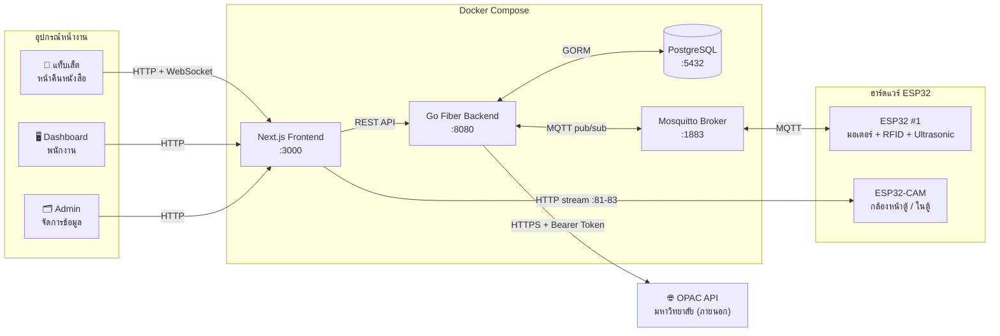
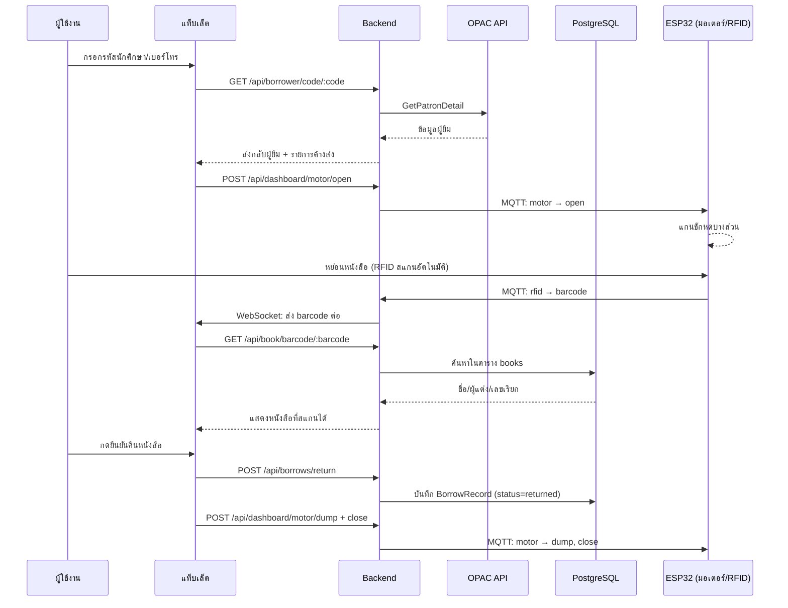
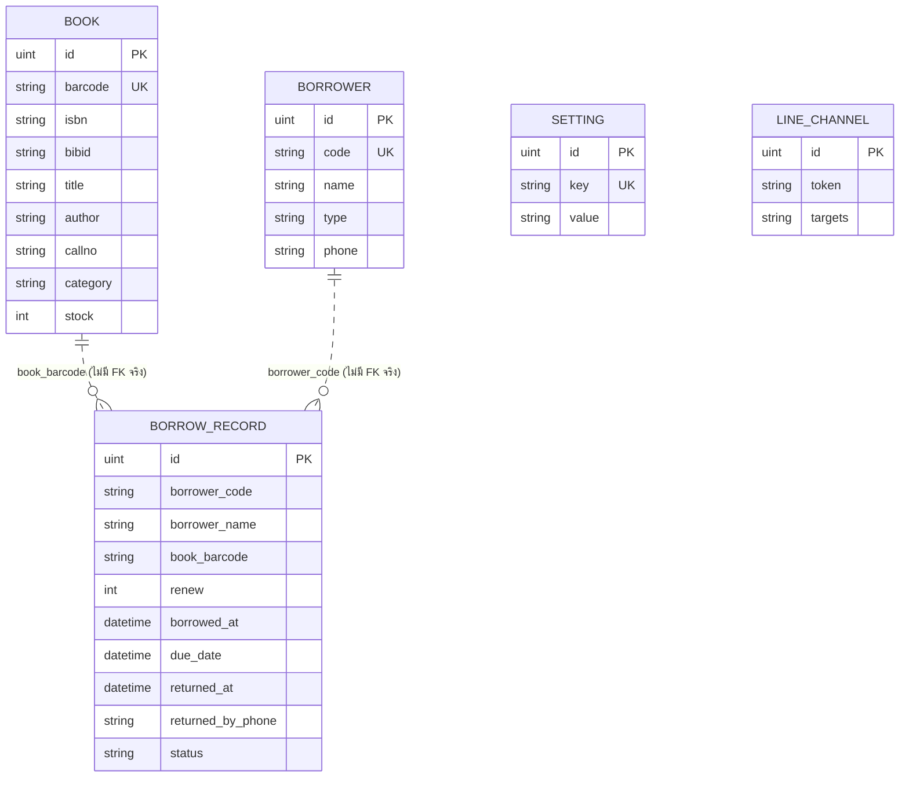

# Smart Library — ระบบตู้รับคืนหนังสืออัตโนมัติ

ระบบตู้รับคืนหนังสืออัตโนมัติสำหรับห้องสมุด ผู้ใช้งานยืนยันตัวตนที่หน้าจอแท็บเล็ต สแกนหนังสือที่จะคืนด้วย RFID แล้วหย่อนลงตู้ที่ควบคุมด้วยมอเตอร์แกนชัก ระบบตรวจสอบข้อมูลผู้ยืม/รายการค้างส่งจาก OPAC ของมหาวิทยาลัยแบบเรียลไทม์ และตรวจหนังสือจากฐานข้อมูลภายในของระบบเอง พร้อมกล้องวงจรปิดบันทึกเหตุการณ์หน้าตู้และในตู้

## สารบัญ

- [ภาพรวมสถาปัตยกรรม](#ภาพรวมสถาปัตยกรรม)
- [ขั้นตอนการคืนหนังสือ](#ขั้นตอนการคืนหนังสือ)
- [เทคโนโลยีที่ใช้](#เทคโนโลยีที่ใช้)
- [หน้าเว็บ (Frontend)](#หน้าเว็บ-frontend)
- [API Endpoints](#api-endpoints)
- [โครงสร้างฐานข้อมูล](#โครงสร้างฐานข้อมูล)
- [ฮาร์ดแวร์ / Firmware](#ฮาร์ดแวร์--firmware)
- [Environment Variables](#environment-variables)
- [การตั้งค่าผ่าน Dashboard](#การตั้งค่าผ่าน-dashboard)
- [การติดตั้งบนเครื่องใหม่ (ละเอียด)](#การติดตั้งบนเครื่องใหม่-ละเอียด)
- [โครงสร้างโปรเจกต์](#โครงสร้างโปรเจกต์)

## ภาพรวมสถาปัตยกรรม



**หลักการออกแบบสำคัญ**: ข้อมูล "ใครยืมอะไรอยู่" มาจาก OPAC ของมหาวิทยาลัยเสมอ (ไม่เก็บซ้ำในระบบนี้) ส่วนข้อมูล "หนังสือเล่มนี้คือเล่มอะไร" (ชื่อ/ผู้แต่ง/เลขเรียก) ใช้ฐานข้อมูลภายในของระบบเอง ซึ่งต้อง[นำเข้าจากไฟล์รายงานของห้องสมุด](#การติดตั้งบนเครื่องใหม่-ละเอียด) ส่วนธุรกรรม "คืนหนังสือสำเร็จแล้ว" เท่านั้นที่บันทึกลงฐานข้อมูลนี้โดยตรง

## ขั้นตอนการคืนหนังสือ



> **กรณีสแกนแล้วหาหนังสือในระบบไม่พบ**: tablet จะเรียก `POST /api/borrows/return-failed` แทน (บันทึกเป็น `BorrowRecord` สถานะ `failed` พร้อมข้อมูลผู้คืนที่ระบุตัวตนไว้แล้ว เป็นหลักฐานว่ามาคืนจริงแต่คืนไม่สำเร็จ) ปิดฝาตู้ แล้วขึ้นหน้าจอแจ้งให้ติดต่อบรรณารักษ์ รายการนี้จะไปปรากฏในหน้า Dashboard/Admin ด้วย

## เทคโนโลยีที่ใช้

| ส่วน | เทคโนโลยี |
|---|---|
| Frontend | Next.js 16, TypeScript, Tailwind CSS 4 |
| Backend | Go, Fiber v2 |
| ฐานข้อมูล | PostgreSQL 16 (ผ่าน GORM) |
| Message Broker | Eclipse Mosquitto (MQTT) |
| Firmware | C++ (Arduino framework) บน ESP32, PlatformIO |
| API ภายนอก | OPAC API ของมหาวิทยาลัย (REST + Bearer Token) |
| Deployment | Docker Compose |

## หน้าเว็บ (Frontend)

| Path | หน้าจอ | ผู้ใช้งาน | หน้าที่ |
|---|---|---|---|
| `/` | Tablet (คืนหนังสือ) | นักศึกษา/บุคคลทั่วไป | ระบุตัวตน → สแกนหนังสือ → ยืนยันคืน มีเสียงพูดแนะนำแต่ละขั้นตอน (ไฟล์เสียงจริงถ้ามี ไม่มีจะพูดด้วยเสียงสังเคราะห์ของเบราว์เซอร์แทน, ปิดได้จาก Dashboard), กลับหน้าแรกอัตโนมัติถ้าไม่มีการใช้งาน, และมีหน้าแจ้งเตือนแยกถ้าสแกนหนังสือแล้วหาในระบบไม่พบ (บันทึกหลักฐานไว้ให้บรรณารักษ์ตรวจสอบย้อนหลังได้) |
| `/dashboard` | แผงควบคุมพนักงาน | เจ้าหน้าที่ห้องสมุด | ดูสถานะตู้, ควบคุมมอเตอร์, กล้องสด/ย้อนหลัง, รายการหนังสือในตู้, รายการคืนผิดพลาด, ตั้งค่าแจ้งเตือนตู้เต็ม (อีเมลหลายรายการ + LINE หลายบัญชี) และตั้งค่าพฤติกรรมของตู้ (ดู[การตั้งค่าผ่าน Dashboard](#การตั้งค่าผ่าน-dashboard)) |
| `/admin` | จัดการข้อมูล | ผู้ดูแลระบบ | CRUD หนังสือ/ผู้ยืม/รายการยืม-คืน (แบ่งหน้า + ค้นหา, แสดงเวลาที่คืนและสถานะคืนผิดพลาด) |
| `/simulator` | เครื่องมือทดสอบ | นักพัฒนา | จำลอง/ควบคุม RFID, มอเตอร์, LED, Fast Mode (เปิดแล้วทดสอบหน้าคืนหนังสือทั้งหมดได้โดยไม่ต้องต่อ ESP32 จริง), โหมดไม่ได้ต่อ Ultrasonic |

## API Endpoints

ทั้งหมดอยู่ใต้ backend (`:8080`) — ดูรายละเอียดคำขอ/คำตอบได้ที่ [backend/internal/routes/routes.go](backend/internal/routes/routes.go)

| Method | Path | หน้าที่ |
|---|---|---|
| `GET` | `/ws/tablet` | WebSocket ส่งสัญญาณ barcode/RFID ไปยังแท็บเล็ต |
| `POST` | `/api/simulator/send` | ส่งสัญญาณจำลอง (barcode/rfid/led/motor) |
| `GET` | `/api/status` | สถานะตู้ + motor log + `esp32_connected` (ใช้โดย tablet/dashboard/simulator) |
| `POST` | `/api/simulate/fast-mode` | เปิด/ปิด Fast Mode (ข้ามดีเลย์มอเตอร์ตอนทดสอบ) |
| `POST` | `/api/simulate/force-empty` | บังคับสถานะตู้ว่างเสมอ (ใช้ตอนยังไม่ได้ต่อ Ultrasonic) |
| `GET` `POST` | `/api/dashboard/cabinet`, `/motor/open`, `/close`, `/dump` | อ่าน/สั่งสถานะตู้และมอเตอร์ |
| `GET` | `/api/dashboard/books-in-cabinet` | รายการหนังสือที่คืนแล้วอยู่ในตู้ (join กับตาราง books, รวมเลข/ชื่อผู้คืน) |
| `POST` | `/api/dashboard/cabinet/reset` | ล้างรายการในตู้ (เปลี่ยนสถานะเป็น archived) |
| `GET` | `/api/dashboard/system-settings` | อ่านค่าตั้งค่าตู้ฝั่งแท็บเล็ต (`dump_settle_ms`, `idle_timeout_ms`, `voice_enabled`) |
| `POST` | `/api/dashboard/system-settings` | บันทึกค่าตั้งค่าตู้ (ดู[รายละเอียดแต่ละค่า](#การตั้งค่าผ่าน-dashboard)) |
| `GET` `POST` | `/api/dashboard/notify-email` | อ่าน/ตั้งรายชื่ออีเมลแจ้งเตือนตอนตู้เต็ม (ได้หลายรายการ, body: `{"emails": [...]}`, ค่าเริ่มต้นถ้ายังไม่ตั้ง `library@rmutsv.ac.th`) |
| `GET` | `/api/dashboard/notify-line` | อ่านรายการ LINE Official Account ที่ตั้งไว้ทั้งหมด (ไม่คืน token จริง มีแค่ `token_configured`) |
| `POST` | `/api/dashboard/notify-line` | เพิ่ม LINE Official Account ใหม่ (body: `channel_access_token`, `targets: [...]`) — รองรับหลายบัญชี แต่ละบัญชีส่งไปคนละปลายทางได้ |
| `PUT` | `/api/dashboard/notify-line/:id` | แก้ไข LINE Official Account (targets ทั้งชุด, `channel_access_token` ปล่อยว่างได้ถ้าไม่เปลี่ยน) |
| `DELETE` | `/api/dashboard/notify-line/:id` | ลบ LINE Official Account |
| `POST` | `/api/line/webhook` | รับ webhook จาก LINE (ใช้ชั่วคราวตอนตั้งค่าครั้งแรกเพื่อหา User/Group ID จาก log) |
| `GET` | `/api/borrower/code/:code` | ค้นหาผู้ยืมจาก OPAC API |
| `GET` | `/api/book/barcode/:barcode` | ค้นหาหนังสือจากฐานข้อมูลภายใน |
| `GET` | `/api/patron/:barcode/borrows` | รายการค้างส่งของผู้ยืม จาก OPAC API |
| `POST` | `/api/borrows/return` | บันทึกการคืนหนังสือ (body: `book_barcode`, `borrower_code`, `borrower_name`, `returned_by_phone`) |
| `POST` | `/api/borrows/return-failed` | บันทึกหลักฐานว่ามาคืนแล้วจริงแต่สแกนหนังสือหาในระบบไม่พบ (status `failed`, body: `borrower_code`, `borrower_name`, `returned_by_phone`, `scanned_barcode`) |
| `GET` `POST` `PUT` `DELETE` | `/api/books`, `/api/borrowers`, `/api/borrows` | CRUD ข้อมูลหนังสือ/ผู้ยืม/รายการยืม-คืน (ใช้โดยหน้า Admin) |

## โครงสร้างฐานข้อมูล



> **หมายเหตุ**: `BorrowRecord` อ้างอิง `book_barcode`/`borrower_code` เป็น string ธรรมดา ไม่ได้ผูก Foreign Key กับ `Book`/`Borrower` เพราะข้อมูลผู้ยืมตัวจริงมาจาก OPAC ภายนอก ตาราง `Borrower` ในระบบนี้แทบไม่ได้ใช้งานแล้ว (เหลือไว้จากเวอร์ชันก่อนต่อ OPAC) ส่วน `borrower_name` เป็นชื่อที่ tablet ดึงมาจาก OPAC ตอนระบุตัวตนแล้วส่งมาเก็บไว้ ณ ตอนคืนหนังสือ (snapshot ตอนนั้น ไม่ sync กับ OPAC อีกทีหลัง) `BorrowRecord.status = "failed"` คือรายการที่สแกนหนังสือแล้วหาในระบบไม่พบ (บันทึกไว้เป็นหลักฐานว่ามาคืนจริง ไม่ใช่การคืนสำเร็จ)
>
> `Setting` เป็นตาราง key-value ทั่วไป เก็บค่าตั้งค่าที่ปรับได้จากหน้า Dashboard ทั้งหมด (อีเมลแจ้งเตือน, ค่าตั้งค่าตู้ `system_*`) ส่วน `LineChannel` แยกเป็นตารางของตัวเอง เพราะรองรับหลาย LINE Official Account พร้อมกัน แต่ละตัวมี Channel Access Token และ `targets` (User/Group ID คั่นด้วยคอมมา) เป็นของตัวเอง

## ฮาร์ดแวร์ / Firmware

### ESP32 #1 — มอเตอร์ + RFID + Ultrasonic ([firmware/libraryBookReturnESP32](firmware/libraryBookReturnESP32))

| ขา GPIO | หน้าที่ |
|---|---|
| 16, 17 | RX2/TX2 — UART อ่านข้อมูลจากเครื่องอ่าน RFID |
| 2 | LED แสดงสถานะ |
| 12, 13 | Trigger / Echo ของเซนเซอร์ Ultrasonic (HC-SR04) ตรวจจับตู้เต็ม |
| 25, 26, 27 | LPWM / RPWM / EN ของ BTS7960 Motor Driver (มอเตอร์แกนชัก 3 ตำแหน่ง: เปิด/ปิด/เท) |

ตั้งค่า WiFi SSID/Password และ IP ของ MQTT Server ไว้ใน `secrets.h` ตอน compile (ไม่มีหน้าเว็บตั้งค่าในตัวบอร์ด — เปลี่ยนค่าต้องแก้ `secrets.h` แล้ว flash ใหม่) ปัจจุบันตั้ง static IP ไว้ (ดูค่าที่ตั้งไว้ใน `main.cpp`) เพราะเครือข่ายที่ทดสอบจริง (hotspot มือถือ "P-Hot") จงใจกำหนด IP นิ่งไว้ให้ทุกบอร์ด ไม่ต้องพึ่ง DHCP

> **⚠️ หมายเหตุ**: subnet ของ hotspot มือถือ **เปลี่ยนได้เอง** ถ้ามือถือมีการอัปเดตระบบ (เจอมาแล้วจริง เปลี่ยนจาก `172.19.128.x` เป็น `10.239.123.x` หลังอัปเดต) ถ้าเจอว่า ESP32/กล้องเชื่อมต่อไม่ได้ทั้งที่ WiFi SSID/Password ถูกต้อง ให้เช็ค subnet ปัจจุบันของเครื่อง server ก่อน (`ipconfig` บน Windows) แล้วแก้ค่าที่ผูกกับ IP ทั้งหมดให้ตรงกันใหม่ (ต้อง flash ใหม่ทั้ง 2 บอร์ด):
> - `STATIC_IP` / `GATEWAY_IP` / `SUBNET_MASK` / `DNS1_IP` ใน `main.cpp` ของ ESP32 มอเตอร์
> - `MQTT_SERVER` ใน `secrets.h` ของ ESP32 มอเตอร์ (ต้องเป็น IP ของเครื่อง server)
> - `GATEWAY_IP` / `DNS1_IP` ใน `main.cpp` ของกล้อง (ใช้ร่วมกันทั้ง 2 บอร์ด)
> - `CAMERA_STATIC_IP` ใน `secrets.h` ของกล้องแต่ละบอร์ด (หน้าตู้/ในตู้ต้องคนละค่า)
> - `NEXT_PUBLIC_CAMERA_*_URL` ใน `frontend/.env` ให้ตรงกับ `CAMERA_STATIC_IP` ใหม่ แล้ว build frontend ใหม่
>
> ส่วน `NEXT_PUBLIC_API_BASE_URL`/`WS_BASE_URL` ไม่ต้องแก้ เพราะปล่อย comment ไว้ให้คำนวณจาก hostname ของเบราว์เซอร์เองอยู่แล้ว (ดู[ตารางด้านล่าง](#environment-variables))

### ESP32-CAM — กล้องวงจรปิด ([firmware/libraryBookReturnCAM](firmware/libraryBookReturnCAM))

| พอร์ต | หน้าที่ |
|---|---|
| 81 | สตรีมวิดีโอสด (MJPEG) |
| 82 | รายการไฟล์วิดีโอย้อนหลัง (บันทึกลง SD การ์ดแบบ loop-recording) |
| 83 | ดาวน์โหลด/เล่นไฟล์วิดีโอย้อนหลัง (รองรับ Range request) |

แยกคนละพอร์ต/คนละ HTTP server ต่อหน้าที่ เพื่อไม่ให้การดูวิดีโอย้อนหลัง (ใช้เวลานาน) บล็อกการสตรีมสดหรือการดึงรายการไฟล์ — ไม่มี MQTT (ไม่ต้องคุยกับ backend เลย เบราว์เซอร์ต่อ IP ของบอร์ดตรงๆ)

### MQTT Topics (ระหว่าง Backend ↔ ESP32 มอเตอร์)

| Topic | ทิศทาง | Payload | หน้าที่ |
|---|---|---|---|
| `smartlibrary/esp32/control` | Backend → ESP32 | `{"type":"motor"\|"led", "value":"open"\|"close"\|"dump"\|"on"\|"off"\|..., "settle_ms":5000}` | สั่งมอเตอร์/LED — `settle_ms` ส่งมาเฉพาะตอน `value:"dump"` เท่านั้น (ค่าที่ตั้งไว้ในหน้า Dashboard) บอก ESP32 ว่าต้องพักเช็คเซนเซอร์ตู้เต็มนานแค่ไหนหลังเทหนังสือเสร็จ กันอ่านค่าเพี้ยนช่วงหนังสือยังตกไม่ถึงพื้น ถ้าไม่มี field นี้มา (เช่น backend เวอร์ชันเก่า) ใช้ค่า default ของเฟิร์มแวร์เอง (5 วินาที) |
| `smartlibrary/esp32/rfid` | ESP32 → Backend | `{"type":"rfid","value":"<barcode1,barcode2,...>"}` | ส่งรหัสที่ RFID อ่านได้ |
| `smartlibrary/esp32/full` | ESP32 → Backend | `{"type":"full","value":"true"\|"false"}` | สถานะตู้เต็มจากเซนเซอร์ Ultrasonic |
| `smartlibrary/esp32/status` | ESP32 → Backend | `"online"` / `"offline"` (retained) | บอกว่า ESP32 ต่อ MQTT อยู่ไหม — `"offline"` ถูกส่งโดย broker เอง (ผ่านกลไก MQTT Last Will & Testament ที่ ESP32 ลงทะเบียนไว้ตอน connect) ถ้า ESP32 หลุดแบบไม่ปกติ (ไฟดับ/สัญญาณขาด) ไม่ต้องรอ ESP32 ส่งเอง — backend ใช้ค่านี้ตัดสินใจว่าจะโชว์หน้าจอ "อุปกรณ์ไม่พร้อมใช้งาน" ที่ tablet ไหม |

## Environment Variables

### `.env` (root — ใช้โดย backend/docker-compose)

| ตัวแปร | ใช้ทำอะไร |
|---|---|
| `POSTGRES_USER`, `POSTGRES_PASSWORD`, `POSTGRES_DB` | ล็อกอิน PostgreSQL |
| `DB_HOST`, `DB_PORT` | Host/Port ของ Postgres ที่ backend เชื่อมต่อ |
| `OPAC_API_URL`, `OPAC_API_TOKEN` | เชื่อมต่อ OPAC API ของมหาวิทยาลัย |
| `SMTP_HOST`, `SMTP_PORT`, `SMTP_USER`, `SMTP_PASSWORD`, `SMTP_FROM` | ส่งอีเมลแจ้งเตือนตอนตู้เต็ม (รองรับ SMTP+STARTTLS พอร์ต 587 เช่น Gmail) — ถ้าไม่ตั้งค่า ระบบจะข้ามการส่งอีเมลไปเฉยๆ ไม่ error |

### `frontend/.env` (ใช้โดย frontend เท่านั้น — อ่านตอน build)

| ตัวแปร | ใช้ทำอะไร |
|---|---|
| `NEXT_PUBLIC_API_BASE_URL`, `NEXT_PUBLIC_WS_BASE_URL` | **ปล่อยว่าง/comment ไว้ได้เลยในกรณีปกติ** ([frontend/src/lib/config.ts](frontend/src/lib/config.ts)) จะคำนวณ URL ของ backend เองจาก hostname ที่เบราว์เซอร์เปิดอยู่ (เพราะ backend รันเครื่องเดียวกับ frontend เสมอ) — ใส่ค่าเฉพาะตอน backend อยู่คนละเครื่อง/คนละโดเมนกับ frontend เท่านั้น |
| `NEXT_PUBLIC_CAMERA_FRONT_URL`, `NEXT_PUBLIC_CAMERA_INSIDE_URL` | URL สตรีมกล้องสด (หน้าตู้ / ในตู้) — ต้องใส่ค่าจริงเสมอ เพราะกล้องเป็นอุปกรณ์แยก คำนวณจาก hostname ของ frontend ไม่ได้ |
| `NEXT_PUBLIC_CAMERA_*_RECORDINGS_URL`, `NEXT_PUBLIC_CAMERA_*_FILE_URL` | URL รายการ/ไฟล์วิดีโอย้อนหลัง — ต้องใส่ค่าจริงเสมอเช่นกัน |

> **หมายเหตุ**: `SMTP_*` ใน `.env` เป็นแค่การตั้งค่า**วิธีส่ง**อีเมล (SMTP server) ส่วน**ผู้รับ**อีเมล/LINE จริงๆ (รายชื่ออีเมล, LINE Official Account) ไม่ได้อยู่ใน `.env` แต่ตั้งผ่านหน้า Dashboard แล้วเก็บในฐานข้อมูลแทน ดู[การตั้งค่าผ่าน Dashboard](#การตั้งค่าผ่าน-dashboard)

## การตั้งค่าผ่าน Dashboard

นอกจาก `.env` ที่ตั้งครั้งเดียวตอนติดตั้ง ยังมีค่าที่ปรับได้ทีหลังผ่านหน้า `/dashboard` โดยไม่ต้อง build/deploy ใหม่ — บันทึกลงฐานข้อมูล (ตาราง `settings`/`line_channels`) มีผลทันทีกับหน้าแท็บเล็ตและ ESP32

### 🔔 ตั้งค่าการแจ้งเตือน

เปิดหน้า `/dashboard` → การ์ด "🔔 การแจ้งเตือนตอนตู้เต็ม" → กด "⚙️ ตั้งค่าการแจ้งเตือน"

**อีเมล** — เพิ่มได้หลายรายการ (พิมพ์แล้วกด "+ เพิ่ม" หรือ Enter) ระบบจะส่งฉบับเดียวถึงทุกคนพร้อมกันทุกครั้งที่ตู้เพิ่งเปลี่ยนจากว่างเป็นเต็ม (ต้องตั้งค่า `SMTP_*` ใน `.env` ไว้ก่อน ไม่งั้นจะ log แจ้งเตือนไว้เฉยๆ ไม่ส่งจริง)

**LINE** — รองรับหลาย LINE Official Account พร้อมกัน แต่ละบัญชีมี Channel Access Token และปลายทาง (User/Group ID) เป็นของตัวเอง ส่งไปคนละกลุ่มได้ ขั้นตอนเตรียมของ LINE ฝั่งเดียว (ทำครั้งเดียวต่อ 1 บัญชี):

1. สร้าง LINE Official Account ที่ [LINE Official Account Manager](https://www.linebiz.com/th/service/line-official-account/) (ฟรี)
2. เปิดใช้ Messaging API ที่ [LINE Developers Console](https://developers.line.biz/console/) แล้วสร้าง Provider/Channel ผูกกับ OA ที่สร้างไว้
3. ในหน้า Channel → แท็บ "Messaging API" → เลื่อนลงหา "Channel access token" → กด Issue แล้วคัดลอกมาใส่ในหน้า Dashboard
4. หาค่า User ID (แจ้งเตือนส่วนตัว) หรือ Group ID (แจ้งเตือนในกลุ่ม):
   - **User ID**: เพิ่ม OA เป็นเพื่อนด้วย QR Code ในหน้า Console แล้วทักแชทคุยกับ OA 1 ครั้ง
   - **Group ID**: เชิญ OA เข้ากลุ่ม LINE แล้วพิมพ์ข้อความอะไรก็ได้ในกลุ่มนั้น
   - ทั้งสองแบบ: ตั้ง Webhook URL ในหน้า Console เป็น `http://<IP เครื่อง server>:8080/api/line/webhook` (เปิดใช้ "Use webhook" ด้วย) แล้วดู backend log (`docker compose logs -f backend`) จะมีบรรทัด `📱 LINE webhook: ได้รับข้อความจาก User ID = ...` หรือ `Group ID = ...` ขึ้นมา คัดลอกค่านั้นไปกรอกในหน้า Dashboard ได้เลย (ปิด Webhook กลับได้หลังจากหาค่าเจอแล้ว ไม่จำเป็นต้องเปิดค้างไว้)

### 🛠️ ตั้งค่าตู้

เปิดหน้า `/dashboard` → การ์ด "🛠️ ตั้งค่าตู้" → กดปุ่มเดียวกัน

| ค่า | ความหมาย | ค่าเริ่มต้น | ช่วงที่ตั้งได้ |
|---|---|---|---|
| ระยะเวลารอให้หนังสือตกลงในตู้ หลังเทเสร็จ | ซอฟต์แวร์รอเท่านี้ก่อนสั่งปิดฝา **และ**บอก ESP32 ให้พักเช็คเซนเซอร์ตู้เต็มนานเท่ากัน กันอ่านค่าเพี้ยนช่วงหนังสือยังตกไม่ถึงพื้น | 5 วินาที | 1–60 วินาที |
| ไม่มีการใช้งานแล้วกลับหน้าแรกอัตโนมัติ | หน้าแท็บเล็ตอยู่ขั้นตอนกลางทาง (ไม่ใช่หน้าแรก) ไม่มีใครแตะจอ/สแกนนานแค่ไหนถึงจะรีเซ็ตกลับหน้าแรกเอง | 10 วินาที | 3–300 วินาที |
| เปิดเสียงพูดแนะนำแต่ละขั้นตอน | เปิด/ปิดเสียงพูดในหน้าแท็บเล็ตทั้งระบบ (ทั้งไฟล์เสียงจริงและเสียงสังเคราะห์สำรอง) | เปิด | เปิด/ปิด |

ไม่มีผลกับระยะมอเตอร์ (เวลาที่แกนชักขยับจริง) เพราะผูกกับระยะทางจริงที่ต้องปรับเทียบที่ฮาร์ดแวร์ ไม่ใช่ค่าที่ควรแก้ผ่านหน้าเว็บ

### 🔊 ไฟล์เสียงพูดในหน้าแท็บเล็ต (ไม่บังคับ)

วางไฟล์ `.mp3` ไว้ที่ `frontend/public/sounds/` ตามชื่อที่ระบุใน [frontend/public/sounds/README.md](frontend/public/sounds/README.md) (เช่น `identify.mp3`, `check-book.mp3`, `drop.mp3`, `success.mp3`, `not-found.mp3`, `cabinet-full.mp3`, `identify-not-found.mp3`) แล้ว build frontend ใหม่ — ถ้ายังไม่มีไฟล์หรือไฟล์ชื่อไม่ตรง ระบบจะพูดด้วยเสียงสังเคราะห์ของเบราว์เซอร์ (Web Speech API) แทนให้อัตโนมัติ ไม่กระทบการใช้งาน

## การติดตั้งบนเครื่องใหม่ (ละเอียด)

### 0. สิ่งที่ต้องมีก่อน

| เครื่องมือ | ใช้ทำอะไร | จำเป็นเสมอไหม |
|---|---|---|
| [Docker](https://docs.docker.com/get-docker/) + Docker Compose | รันทั้งระบบ (frontend/backend/postgres/mqtt) | ✅ จำเป็นเสมอ |
| Git | clone โปรเจกต์ | ✅ จำเป็นเสมอ |
| [Go](https://go.dev/dl/) 1.21+ | รันเครื่องมือนำเข้ารายชื่อหนังสือ (`importbooks`) | ใช้เฉพาะตอนนำเข้า/อัปเดตรายชื่อหนังสือ |
| [PlatformIO](https://platformio.org/) (ผ่าน VS Code extension หรือ CLI) | compile/upload firmware ให้ ESP32 | ใช้เฉพาะตอน flash ฮาร์ดแวร์ใหม่/เปลี่ยนเครือข่าย |
| บัญชี Gmail (หรือผู้ให้บริการ SMTP อื่น) | ส่งอีเมลแจ้งเตือนตู้เต็ม | ไม่บังคับ (ข้ามได้ถ้าไม่ต้องการแจ้งเตือนทางอีเมล) |

### 1. Clone โปรเจกต์

```bash
git clone <URL ของ repo นี้>
cd smart-library
```

### 2. ตั้งค่า environment variables

```bash
cp .env.example .env
cp frontend/.env.example frontend/.env
```

แก้ไขค่าในไฟล์ทั้งสองให้ตรงกับเครื่อง/เครือข่ายจริง (ดูความหมายแต่ละตัวแปรใน[ตารางด้านบน](#environment-variables)) ที่ต้องแก้แน่ๆ:

- `.env`: `OPAC_API_URL`/`OPAC_API_TOKEN` (ขอจากฝ่าย IT ของมหาวิทยาลัย) — ถ้าจะใช้แจ้งเตือนทางอีเมลด้วย ใส่ `SMTP_*` ไปด้วย (เช่น Gmail ต้องสร้าง [App Password](https://myaccount.google.com/apppasswords) มาใส่ `SMTP_PASSWORD` ใช้รหัสผ่านบัญชีจริงไม่ได้) ส่วน `POSTGRES_*`/`DB_HOST`/`DB_PORT` ปล่อยเป็นค่า default ที่มาให้ได้เลยถ้าไม่ได้ต้องการเปลี่ยนรหัสฐานข้อมูล
- `frontend/.env`: `NEXT_PUBLIC_CAMERA_FRONT_URL`/`NEXT_PUBLIC_CAMERA_INSIDE_URL` และ `*_RECORDINGS_URL`/`*_FILE_URL` ให้ตรงกับ IP จริงของกล้องทั้งสองตัว (ดูได้จาก `CAMERA_STATIC_IP` ที่ตั้งไว้ตอน flash แต่ละบอร์ด) — `NEXT_PUBLIC_API_BASE_URL`/`WS_BASE_URL` ปล่อย comment ไว้แบบเดิมได้เลยถ้า backend รันเครื่องเดียวกับ frontend (กรณีปกติ)

### 3. เปิดระบบ

```bash
docker compose up -d --build
```

ครั้งแรกจะ build image ของ frontend/backend ใหม่ (ใช้เวลาสักครู่) แล้ว Postgres จะสร้างตารางทั้งหมดให้อัตโนมัติ (GORM AutoMigrate ตอน backend เริ่มทำงาน ไม่ต้องรัน migration เองแยก) ตรวจว่าทุก container ขึ้นมาปกติด้วย:

```bash
docker compose ps        # ทั้ง 4 ตัว (db, mqtt, backend, frontend) ต้องเป็น "running"/"healthy"
docker compose logs -f backend   # ดู log สด เช็คว่าไม่มี error ต่อฐานข้อมูล/MQTT
```

จากนั้นเปิด **http://localhost:3000** (หน้าคืนหนังสือ) และ **http://localhost:3000/dashboard** (แผงควบคุม) ในเบราว์เซอร์ได้เลย

### 4. นำเข้ารายชื่อหนังสือ (สำคัญ — ไม่ทำอัตโนมัติ)

ฐานข้อมูลหนังสือ (`books`) จะว่างเปล่าตอนเริ่มต้นเสมอ ต้องนำเข้าจากไฟล์รายงานของห้องสมุดเอง:

```bash
cd backend
DB_HOST=localhost DB_USER=admin DB_PASSWORD=<รหัสใน .env> DB_NAME=library DB_PORT=5432 \
  go run ./cmd/importbooks "ที่อยู่ไฟล์\รายงานรายการทรัพยากรทั้งหมด (ITEM).xlsx"
```

- ไฟล์ต้องเป็นรายงาน Export จากระบบห้องสมุด คอลัมน์: `BARCODE, BIBID, ITEMID, CALLNO, UNIT, COPY, TITLE, AUTHOR, LANG, PUBBEYEAR, COLLECTIONNAME, ITEMCLASSNAME, ITEMSTATUSNAME, MATTYPENAME, LOCATIONNAMETHAI`
- รันซ้ำได้เรื่อยๆ ไม่สร้างข้อมูลซ้ำ (upsert ตาม Barcode) ใช้ตอนห้องสมุด export รายงานชุดใหม่มาก็ได้ (ใช้เวลา ~10-15 วินาทีต่อข้อมูล 90,000 รายการ)
- ต้องใช้ Go ลงเครื่อง (ดูขั้นตอนที่ 0) และรันนอก Docker ตรงๆ (`DB_HOST=localhost` เพราะเครื่องนี้ไม่ได้อยู่ใน network เดียวกับ container `db`)

### 5. ตั้งค่าแจ้งเตือน/ตั้งค่าตู้ (ไม่บังคับ แต่แนะนำ)

เปิด `/dashboard` แล้วตั้งค่าตามต้องการ — ดูขั้นตอนละเอียดที่ [การตั้งค่าผ่าน Dashboard](#การตั้งค่าผ่าน-dashboard) ด้านบน (ตั้งอีเมล/LINE แจ้งเตือนตอนตู้เต็ม, ปรับเวลาต่างๆ, เปิด/ปิดเสียงพูด) ข้ามขั้นตอนนี้ไปก่อนได้ ระบบใช้งานได้ปกติด้วยค่า default

### 6. (ถ้าต้อง flash ฮาร์ดแวร์ใหม่) ตั้งค่า WiFi/MQTT ของ ESP32

```bash
cp firmware/libraryBookReturnESP32/include/secrets.h.example firmware/libraryBookReturnESP32/include/secrets.h
cp firmware/libraryBookReturnCAM/include/secrets.h.example firmware/libraryBookReturnCAM/include/secrets.h
```

ใส่ WiFi SSID/Password และ IP ของเครื่องที่รัน MQTT broker (`MQTT_SERVER`) ให้ตรงกับเครื่องจริง แล้ว build/upload ผ่าน PlatformIO ตามปกติ (เปิดโฟลเดอร์ `firmware/libraryBookReturnESP32` หรือ `firmware/libraryBookReturnCAM` ด้วย VS Code ที่ลง PlatformIO extension แล้ว กด Upload) — ไฟล์ `secrets.h` ไม่ถูก commit เข้า git (มีแค่ `.example` ให้)

**ถ้าเครือข่ายใหม่ไม่เหมือนเดิม** ต้องแก้ค่า static IP ใน `main.cpp` ของทั้ง 2 บอร์ดด้วย (`STATIC_IP`/`GATEWAY_IP`/`SUBNET_MASK` ของมอเตอร์, `CAMERA_STATIC_IP` ใน `secrets.h` ของกล้อง — หน้าตู้/ในตู้ต้องตั้งคนละค่ากัน) ดูวิธีหา Gateway/Subnet จริงได้จาก `ipconfig`/`ip addr` ตอนเครื่อง server ต่อเครือข่ายนั้น และดู[หมายเหตุเรื่อง subnet ของ hotspot เปลี่ยนเองได้](#ฮาร์ดแวร์--firmware)ด้านบนประกอบด้วย

กล้องแต่ละบอร์ด (หน้าตู้/ในตู้) ใช้โค้ด `main.cpp` เดียวกัน แต่ต้องแก้ `CAMERA_STATIC_IP` ใน `secrets.h` ให้ต่างกันก่อน upload แต่ละบอร์ด ไม่งั้น IP จะชนกัน

### 7. ตรวจสอบว่าระบบพร้อมใช้งานจริง

ไล่เช็คทีละข้อ:

1. เปิด `/dashboard` → การ์ด "การเชื่อมต่อ ESP32" ต้องขึ้น **Online** (สีเขียว) — ถ้าขึ้น "ESP32 ไม่เชื่อมต่อ" ให้เช็ค WiFi/MQTT ของบอร์ดมอเตอร์ตามขั้นตอนที่ 6
2. ที่หน้า `/dashboard` เช่นกัน ลองกดปุ่ม "เปิด"/"ปิด" ในการ์ด "ควบคุมตู้รับคืน" ดูว่ามอเตอร์ขยับจริงไหม
3. เปิดแท็บกล้องในหน้า `/dashboard` ดูว่าภาพสดขึ้นทั้งกล้องหน้าตู้และในตู้ (ถ้าไม่ขึ้น เช็ค `NEXT_PUBLIC_CAMERA_*_URL` ใน `frontend/.env` ว่าตรงกับ `CAMERA_STATIC_IP` จริงไหม แล้ว build frontend ใหม่)
4. เปิด `/` (หน้าคืนหนังสือ) ทดลองกรอกเบอร์โทร 10 หลักแบบ Guest (ไม่ต้องมีบัตรนักศึกษาจริง) → กด "เริ่มต้น" → ตู้ควรเปิด → สแกน/พิมพ์บาร์โค้ดหนังสือที่นำเข้าไว้แล้วในขั้นตอนที่ 4 → ควรเจอชื่อหนังสือขึ้นมา → กดยืนยันคืน → ตู้เทและปิดจนจบ
5. เช็คที่ `/admin` ว่ารายการคืนที่เพิ่งทดสอบขึ้นมาจริง พร้อมเวลาคืนที่ถูกต้อง

## โครงสร้างโปรเจกต์

```
backend/
├── cmd/
│   ├── server/        จุดเริ่มต้นรัน backend
│   └── importbooks/   เครื่องมือนำเข้ารายชื่อหนังสือจาก Excel
└── internal/
    ├── api/            ไคลเอนต์เรียก OPAC API ภายนอก
    ├── database/        เชื่อมต่อ + migrate PostgreSQL (+ migrate ข้อมูล LINE แบบเก่าอัตโนมัติถ้ามี)
    ├── handlers/        HTTP handlers ทั้งหมด
    ├── hardware/        สถานะตู้/มอเตอร์แบบ in-memory
    ├── models/          GORM models (Book, Borrower, BorrowRecord, Setting, LineChannel)
    ├── notify/          ส่งแจ้งเตือนตู้เต็ม (email.go, line.go)
    └── routes/          ลงทะเบียนเส้นทาง API ทั้งหมด

frontend/
├── public/sounds/        ไฟล์เสียงพูดแนะนำหน้าแท็บเล็ต (ไม่บังคับ ดู README.md ในโฟลเดอร์นี้)
└── src/
    ├── app/
    │   ├── page.tsx          หน้าคืนหนังสือ (tablet)
    │   ├── dashboard/        แผงควบคุมพนักงาน
    │   ├── admin/            จัดการข้อมูล
    │   └── simulator/        เครื่องมือทดสอบสำหรับนักพัฒนา
    ├── components/           AviMjpegPlayer, ScaleWrapper, AnimatedBackground, NavBar
    └── lib/config.ts         อ่านค่า environment variables ฝั่ง client

firmware/
├── libraryBookReturnESP32/   มอเตอร์ + RFID + Ultrasonic
└── libraryBookReturnCAM/     กล้อง ESP32-CAM
```
