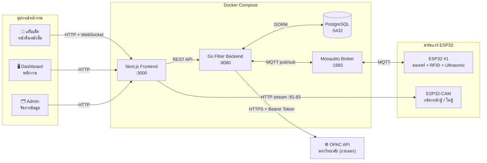
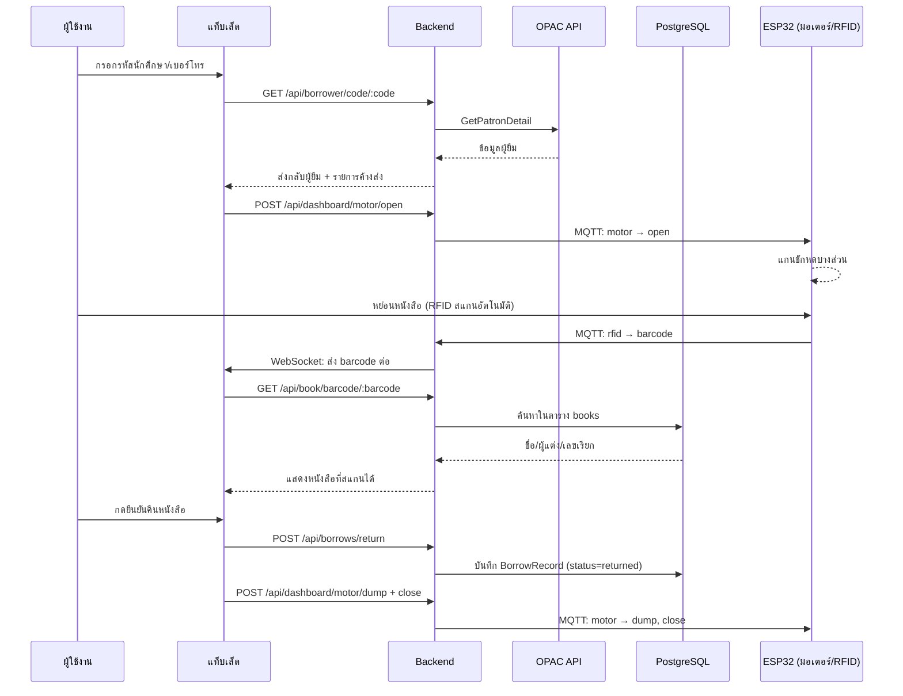
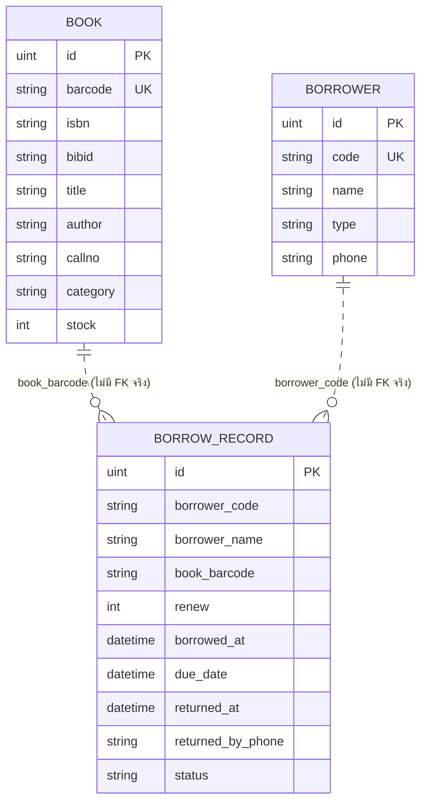

# Smart Library — ระบบตู้รับคืนหนังสืออัตโนมัติ

ระบบตู้รับคืนหนังสืออัตโนมัติสำหรับห้องสมุด ผู้ใช้งานยืนยันตัวตนที่หน้าจอแท็บเล็ต สแกนหนังสือที่จะคืนด้วย RFID แล้วหย่อนลงตู้ที่ควบคุมด้วยมอเตอร์แกนชัก ระบบตรวจสอบข้อมูลผู้ยืม/รายการค้างส่งจาก OPAC ของมหาวิทยาลัยแบบเรียลไทม์ และตรวจหนังสือจากฐานข้อมูลภายในของระบบเอง พร้อมกล้องวงจรปิดบันทึกเหตุการณ์หน้าตู้และในตู้

## สารบัญ

- [ภาพรวมสถาปัตยกรรม](#ภาพรวมสถาปัตยกรรม)
- [ขั้นตอนการคืนหนังสือ](#ขั้นตอนการคืนหนังสือ)
- [เทคโนโลยีที่ใช้](#เทคโนโลยีที่ใช้)
- [หน้าเว็บ (Frontend)](#หน้าเว็บ-frontend)
- [API Endpoints](#api-endpoints)
- [โครงสร้างฐานข้อมูล](#โครงสร้างฐานข้อมูล)
- [ฮาร์ดแวร์ / Firmware](#ฮาร์ดแวร์--firmware)
- [Environment Variables](#environment-variables)
- [การติดตั้งบนเครื่องใหม่](#การติดตั้งบนเครื่องใหม่)
- [โครงสร้างโปรเจกต์](#โครงสร้างโปรเจกต์)

## ภาพรวมสถาปัตยกรรม



**หลักการออกแบบสำคัญ**: ข้อมูล "ใครยืมอะไรอยู่" มาจาก OPAC ของมหาวิทยาลัยเสมอ (ไม่เก็บซ้ำในระบบนี้) ส่วนข้อมูล "หนังสือเล่มนี้คือเล่มอะไร" (ชื่อ/ผู้แต่ง/เลขเรียก) ใช้ฐานข้อมูลภายในของระบบเอง ซึ่งต้อง[นำเข้าจากไฟล์รายงานของห้องสมุด](#การติดตั้งบนเครื่องใหม่) ส่วนธุรกรรม "คืนหนังสือสำเร็จแล้ว" เท่านั้นที่บันทึกลงฐานข้อมูลนี้โดยตรง

## ขั้นตอนการคืนหนังสือ



## เทคโนโลยีที่ใช้

| ส่วน | เทคโนโลยี |
|---|---|
| Frontend | Next.js 16, TypeScript, Tailwind CSS 4 |
| Backend | Go, Fiber v2 |
| ฐานข้อมูล | PostgreSQL 16 (ผ่าน GORM) |
| Message Broker | Eclipse Mosquitto (MQTT) |
| Firmware | C++ (Arduino framework) บน ESP32, PlatformIO |
| API ภายนอก | OPAC API ของมหาวิทยาลัย (REST + Bearer Token) |
| Deployment | Docker Compose |

## หน้าเว็บ (Frontend)

| Path | หน้าจอ | ผู้ใช้งาน | หน้าที่ |
|---|---|---|---|
| `/` | Tablet (คืนหนังสือ) | นักศึกษา/บุคคลทั่วไป | ระบุตัวตน → สแกนหนังสือ → ยืนยันคืน |
| `/dashboard` | แผงควบคุมพนักงาน | เจ้าหน้าที่ห้องสมุด | ดูสถานะตู้, ควบคุมมอเตอร์, กล้องสด/ย้อนหลัง, รายการหนังสือในตู้, ตั้งอีเมลแจ้งเตือนตู้เต็ม |
| `/admin` | จัดการข้อมูล | ผู้ดูแลระบบ | CRUD หนังสือ/ผู้ยืม/รายการยืม-คืน (แบ่งหน้า + ค้นหา) |
| `/simulator` | เครื่องมือทดสอบ | นักพัฒนา | จำลอง/ควบคุม RFID, มอเตอร์, LED, Fast Mode (เปิดแล้วทดสอบหน้าคืนหนังสือทั้งหมดได้โดยไม่ต้องต่อ ESP32 จริง), โหมดไม่ได้ต่อ Ultrasonic |

## API Endpoints

ทั้งหมดอยู่ใต้ backend (`:8080`) — ดูรายละเอียดคำขอ/คำตอบได้ที่ [backend/internal/routes/routes.go](backend/internal/routes/routes.go)

| Method | Path | หน้าที่ |
|---|---|---|
| `GET` | `/ws/tablet` | WebSocket ส่งสัญญาณ barcode/RFID ไปยังแท็บเล็ต |
| `POST` | `/api/simulator/send` | ส่งสัญญาณจำลอง (barcode/rfid/led/motor) |
| `GET` | `/api/status` | สถานะตู้ + motor log + `esp32_connected` (ใช้โดย tablet/dashboard/simulator) |
| `POST` | `/api/simulate/fast-mode` | เปิด/ปิด Fast Mode (ข้ามดีเลย์มอเตอร์ตอนทดสอบ) |
| `POST` | `/api/simulate/force-empty` | บังคับสถานะตู้ว่างเสมอ (ใช้ตอนยังไม่ได้ต่อ Ultrasonic) |
| `GET` `POST` | `/api/dashboard/cabinet`, `/motor/open`, `/close`, `/dump` | อ่าน/สั่งสถานะตู้และมอเตอร์ |
| `GET` | `/api/dashboard/books-in-cabinet` | รายการหนังสือที่คืนแล้วอยู่ในตู้ (join กับตาราง books, รวมเลข/ชื่อผู้คืน) |
| `POST` | `/api/dashboard/cabinet/reset` | ล้างรายการในตู้ (เปลี่ยนสถานะเป็น archived) |
| `GET` `POST` | `/api/dashboard/notify-email` | อ่าน/ตั้งอีเมลแจ้งเตือนตอนตู้เต็ม (ค่าเริ่มต้น `library@rmutsv.ac.th`) |
| `GET` `POST` | `/api/dashboard/notify-line` | อ่าน/ตั้งค่าแจ้งเตือนทาง LINE ตอนตู้เต็ม (ผ่าน LINE Messaging API — body: `channel_access_token`, `target_id`) |
| `POST` | `/api/line/webhook` | รับ webhook จาก LINE (ใช้ชั่วคราวตอนตั้งค่าครั้งแรกเพื่อหา User/Group ID จาก log) |
| `GET` | `/api/borrower/code/:code` | ค้นหาผู้ยืมจาก OPAC API |
| `GET` | `/api/book/barcode/:barcode` | ค้นหาหนังสือจากฐานข้อมูลภายใน |
| `GET` | `/api/patron/:barcode/borrows` | รายการค้างส่งของผู้ยืม จาก OPAC API |
| `POST` | `/api/borrows/return` | บันทึกการคืนหนังสือ (body: `book_barcode`, `borrower_code`, `borrower_name`, `returned_by_phone`) |
| `POST` | `/api/borrows/return-failed` | บันทึกหลักฐานว่ามาคืนแล้วจริงแต่สแกนหนังสือหาในระบบไม่พบ (status `failed`, body: `borrower_code`, `borrower_name`, `returned_by_phone`, `scanned_barcode`) |
| `GET` `POST` `PUT` `DELETE` | `/api/books`, `/api/borrowers`, `/api/borrows` | CRUD ข้อมูลหนังสือ/ผู้ยืม/รายการยืม-คืน (ใช้โดยหน้า Admin) |

## โครงสร้างฐานข้อมูล



> **หมายเหตุ**: `BorrowRecord` อ้างอิง `book_barcode`/`borrower_code` เป็น string ธรรมดา ไม่ได้ผูก Foreign Key กับ `Book`/`Borrower` เพราะข้อมูลผู้ยืมตัวจริงมาจาก OPAC ภายนอก ตาราง `Borrower` ในระบบนี้แทบไม่ได้ใช้งานแล้ว (เหลือไว้จากเวอร์ชันก่อนต่อ OPAC) ส่วน `borrower_name` เป็นชื่อที่ tablet ดึงมาจาก OPAC ตอนระบุตัวตนแล้วส่งมาเก็บไว้ ณ ตอนคืนหนังสือ (snapshot ตอนนั้น ไม่ sync กับ OPAC อีกทีหลัง)

## ฮาร์ดแวร์ / Firmware

### ESP32 #1 — มอเตอร์ + RFID + Ultrasonic ([firmware/libraryBookReturnESP32](firmware/libraryBookReturnESP32))

| ขา GPIO | หน้าที่ |
|---|---|
| 16, 17 | RX2/TX2 — UART อ่านข้อมูลจากเครื่องอ่าน RFID |
| 2 | LED แสดงสถานะ |
| 12, 13 | Trigger / Echo ของเซนเซอร์ Ultrasonic (HC-SR04) ตรวจจับตู้เต็ม |
| 25, 26, 27 | LPWM / RPWM / EN ของ BTS7960 Motor Driver (มอเตอร์แกนชัก 3 ตำแหน่ง: เปิด/ปิด/เท) |

ตั้งค่า WiFi SSID/Password และ IP ของ MQTT Server ไว้ใน `secrets.h` ตอน compile (ไม่มีหน้าเว็บตั้งค่าในตัวบอร์ด — เปลี่ยนค่าต้องแก้ `secrets.h` แล้ว flash ใหม่) ปัจจุบันตั้ง static IP ไว้ (ดูค่าที่ตั้งไว้ใน `main.cpp`) เพราะเครือข่ายที่ทดสอบจริง (hotspot มือถือ) ให้ IP นิ่งอยู่แล้วตามธรรมชาติ — ถ้าย้ายไปเครือข่ายอื่นที่ DHCP ไม่นิ่ง อาจต้องปรับ Gateway/Subnet ให้ตรงใหม่ หรือลบส่วน `WiFi.config(...)` ออกเพื่อกลับไปใช้ DHCP ปกติ

### ESP32-CAM — กล้องวงจรปิด ([firmware/libraryBookReturnCAM](firmware/libraryBookReturnCAM))

| พอร์ต | หน้าที่ |
|---|---|
| 81 | สตรีมวิดีโอสด (MJPEG) |
| 82 | รายการไฟล์วิดีโอย้อนหลัง (บันทึกลง SD การ์ดแบบ loop-recording) |
| 83 | ดาวน์โหลด/เล่นไฟล์วิดีโอย้อนหลัง (รองรับ Range request) |

แยกคนละพอร์ต/คนละ HTTP server ต่อหน้าที่ เพื่อไม่ให้การดูวิดีโอย้อนหลัง (ใช้เวลานาน) บล็อกการสตรีมสดหรือการดึงรายการไฟล์ — ไม่มี MQTT (ไม่ต้องคุยกับ backend เลย เบราว์เซอร์ต่อ IP ของบอร์ดตรงๆ)

### MQTT Topics (ระหว่าง Backend ↔ ESP32 มอเตอร์)

| Topic | ทิศทาง | Payload | หน้าที่ |
|---|---|---|---|
| `smartlibrary/esp32/control` | Backend → ESP32 | `{"type":"motor"\|"led", "value":"open"\|"close"\|"dump"\|"on"\|"off"\|...}` | สั่งมอเตอร์/LED |
| `smartlibrary/esp32/rfid` | ESP32 → Backend | `{"type":"rfid","value":"<barcode1,barcode2,...>"}` | ส่งรหัสที่ RFID อ่านได้ |
| `smartlibrary/esp32/full` | ESP32 → Backend | `{"type":"full","value":"true"\|"false"}` | สถานะตู้เต็มจากเซนเซอร์ Ultrasonic |
| `smartlibrary/esp32/status` | ESP32 → Backend | `"online"` / `"offline"` (retained) | บอกว่า ESP32 ต่อ MQTT อยู่ไหม — `"offline"` ถูกส่งโดย broker เอง (ผ่านกลไก MQTT Last Will & Testament ที่ ESP32 ลงทะเบียนไว้ตอน connect) ถ้า ESP32 หลุดแบบไม่ปกติ (ไฟดับ/สัญญาณขาด) ไม่ต้องรอ ESP32 ส่งเอง — backend ใช้ค่านี้ตัดสินใจว่าจะโชว์หน้าจอ "อุปกรณ์ไม่พร้อมใช้งาน" ที่ tablet ไหม |

## Environment Variables

### `.env` (root — ใช้โดย backend/docker-compose)

| ตัวแปร | ใช้ทำอะไร |
|---|---|
| `POSTGRES_USER`, `POSTGRES_PASSWORD`, `POSTGRES_DB` | ล็อกอิน PostgreSQL |
| `DB_HOST`, `DB_PORT` | Host/Port ของ Postgres ที่ backend เชื่อมต่อ |
| `OPAC_API_URL`, `OPAC_API_TOKEN` | เชื่อมต่อ OPAC API ของมหาวิทยาลัย |
| `SMTP_HOST`, `SMTP_PORT`, `SMTP_USER`, `SMTP_PASSWORD`, `SMTP_FROM` | ส่งอีเมลแจ้งเตือนตอนตู้เต็ม (รองรับ SMTP+STARTTLS พอร์ต 587 เช่น Gmail) — ถ้าไม่ตั้งค่า ระบบจะข้ามการส่งอีเมลไปเฉยๆ ไม่ error |

### `frontend/.env` (ใช้โดย frontend เท่านั้น — อ่านตอน build)

| ตัวแปร | ใช้ทำอะไร |
|---|---|
| `NEXT_PUBLIC_API_BASE_URL`, `NEXT_PUBLIC_WS_BASE_URL` | **ปล่อยว่าง/comment ไว้ได้เลยในกรณีปกติ** ([frontend/src/lib/config.ts](frontend/src/lib/config.ts)) จะคำนวณ URL ของ backend เองจาก hostname ที่เบราว์เซอร์เปิดอยู่ (เพราะ backend รันเครื่องเดียวกับ frontend เสมอ) — ใส่ค่าเฉพาะตอน backend อยู่คนละเครื่อง/คนละโดเมนกับ frontend เท่านั้น |
| `NEXT_PUBLIC_CAMERA_FRONT_URL`, `NEXT_PUBLIC_CAMERA_INSIDE_URL` | URL สตรีมกล้องสด (หน้าตู้ / ในตู้) — ต้องใส่ค่าจริงเสมอ เพราะกล้องเป็นอุปกรณ์แยก คำนวณจาก hostname ของ frontend ไม่ได้ |
| `NEXT_PUBLIC_CAMERA_*_RECORDINGS_URL`, `NEXT_PUBLIC_CAMERA_*_FILE_URL` | URL รายการ/ไฟล์วิดีโอย้อนหลัง — ต้องใส่ค่าจริงเสมอเช่นกัน |

## การติดตั้งบนเครื่องใหม่

### 1. ตั้งค่า environment variables

```bash
cp .env.example .env
cp frontend/.env.example frontend/.env
```

แก้ไขค่าในไฟล์ทั้งสองให้ตรงกับเครื่อง/เครือข่ายจริง (ดูความหมายแต่ละตัวแปรใน[ตารางด้านบน](#environment-variables))

### 2. เปิดระบบ

```bash
docker compose up -d --build
```

### 3. นำเข้ารายชื่อหนังสือ (สำคัญ — ไม่ทำอัตโนมัติ)

ฐานข้อมูลหนังสือ (`books`) จะว่างเปล่าตอนเริ่มต้นเสมอ ต้องนำเข้าจากไฟล์รายงานของห้องสมุดเอง:

```bash
cd backend
DB_HOST=localhost DB_USER=admin DB_PASSWORD=<รหัสใน .env> DB_NAME=library DB_PORT=5432 \
  go run ./cmd/importbooks "ที่อยู่ไฟล์\รายงานรายการทรัพยากรทั้งหมด (ITEM).xlsx"
```

- ไฟล์ต้องเป็นรายงาน Export จากระบบห้องสมุด คอลัมน์: `BARCODE, BIBID, ITEMID, CALLNO, UNIT, COPY, TITLE, AUTHOR, LANG, PUBBEYEAR, COLLECTIONNAME, ITEMCLASSNAME, ITEMSTATUSNAME, MATTYPENAME, LOCATIONNAMETHAI`
- รันซ้ำได้เรื่อยๆ ไม่สร้างข้อมูลซ้ำ (upsert ตาม Barcode) ใช้ตอนห้องสมุด export รายงานชุดใหม่มาก็ได้ (ใช้เวลา ~10-15 วินาทีต่อข้อมูล 90,000 รายการ)

### 4. (ถ้าต้อง flash ฮาร์ดแวร์ใหม่) ตั้งค่า WiFi/MQTT ของ ESP32

```bash
cp firmware/libraryBookReturnESP32/include/secrets.h.example firmware/libraryBookReturnESP32/include/secrets.h
cp firmware/libraryBookReturnCAM/include/secrets.h.example firmware/libraryBookReturnCAM/include/secrets.h
```

ใส่ WiFi SSID/Password และ IP ของเครื่องที่รัน MQTT broker (`MQTT_SERVER`) ให้ตรงกับเครื่องจริง แล้ว build/upload ผ่าน PlatformIO ตามปกติ — ไฟล์ `secrets.h` ไม่ถูก commit เข้า git (มีแค่ `.example` ให้)

**ถ้าเครือข่ายใหม่ไม่เหมือนเดิม** ต้องแก้ค่า static IP ใน `main.cpp` ของทั้ง 2 บอร์ดด้วย (`STATIC_IP`/`GATEWAY_IP`/`SUBNET_MASK` ของมอเตอร์, `CAMERA_STATIC_IP` ใน `secrets.h` ของกล้อง — หน้าตู้/ในตู้ต้องตั้งคนละค่ากัน) ดูวิธีหา Gateway/Subnet จริงได้จาก `ipconfig`/`ip addr` ตอนเครื่อง server ต่อเครือข่ายนั้น

## โครงสร้างโปรเจกต์

```
backend/
├── cmd/
│   ├── server/        จุดเริ่มต้นรัน backend
│   └── importbooks/   เครื่องมือนำเข้ารายชื่อหนังสือจาก Excel
└── internal/
    ├── api/            ไคลเอนต์เรียก OPAC API ภายนอก
    ├── database/        เชื่อมต่อ + migrate PostgreSQL
    ├── handlers/        HTTP handlers ทั้งหมด
    ├── hardware/        สถานะตู้/มอเตอร์แบบ in-memory
    ├── models/          GORM models (Book, Borrower, BorrowRecord)
    └── routes/          ลงทะเบียนเส้นทาง API ทั้งหมด

frontend/src/
├── app/
│   ├── page.tsx          หน้าคืนหนังสือ (tablet)
│   ├── dashboard/        แผงควบคุมพนักงาน
│   ├── admin/            จัดการข้อมูล
│   └── simulator/        เครื่องมือทดสอบสำหรับนักพัฒนา
├── components/           AviMjpegPlayer, ScaleWrapper, AnimatedBackground
└── lib/config.ts         อ่านค่า environment variables ฝั่ง client

firmware/
├── libraryBookReturnESP32/   มอเตอร์ + RFID + Ultrasonic
└── libraryBookReturnCAM/     กล้อง ESP32-CAM
```
