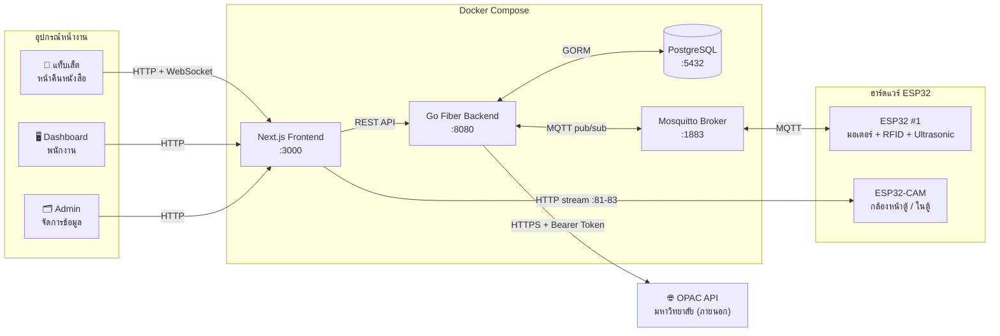
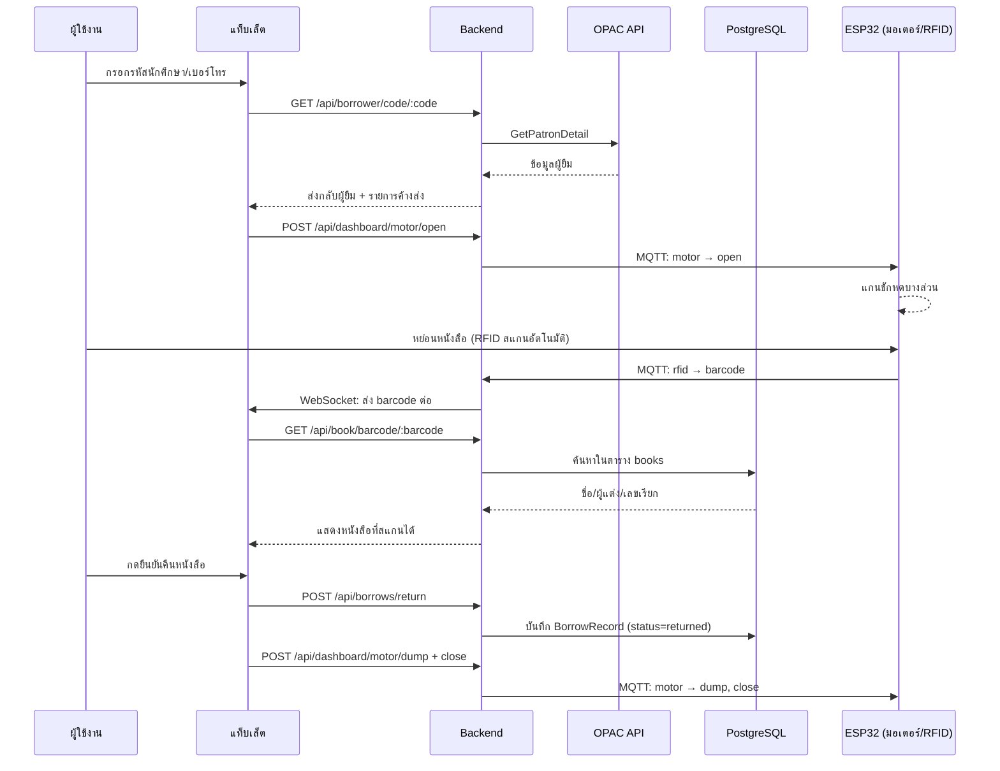
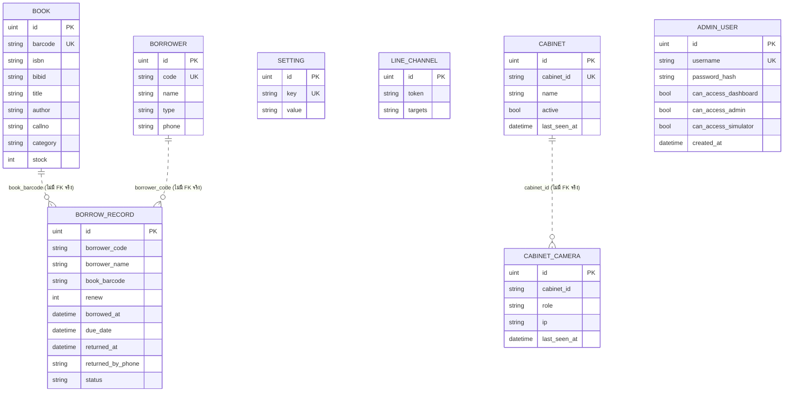

# Smart Library — ระบบตู้รับคืนหนังสืออัตโนมัติ

ระบบตู้รับคืนหนังสืออัตโนมัติสำหรับห้องสมุด ผู้ใช้งานยืนยันตัวตนที่หน้าจอแท็บเล็ต สแกนหนังสือที่จะคืนด้วย RFID แล้วหย่อนลงตู้ที่ควบคุมด้วยมอเตอร์แกนชัก ระบบตรวจสอบข้อมูลผู้ยืม/รายการค้างส่งจาก OPAC ของมหาวิทยาลัยแบบเรียลไทม์ และตรวจหนังสือจากฐานข้อมูลภายในของระบบเอง พร้อมกล้องวงจรปิดบันทึกเหตุการณ์หน้าตู้และในตู้

## สารบัญ

- [ภาพรวมสถาปัตยกรรม](#ภาพรวมสถาปัตยกรรม)
- [ขั้นตอนการคืนหนังสือ](#ขั้นตอนการคืนหนังสือ)
- [เทคโนโลยีที่ใช้](#เทคโนโลยีที่ใช้)
- [หน้าเว็บ (Frontend)](#หน้าเว็บ-frontend)
- [ระบบ Login](#ระบบ-login)
- [API Endpoints](#api-endpoints)
- [โครงสร้างฐานข้อมูล](#โครงสร้างฐานข้อมูล)
- [ฮาร์ดแวร์ / Firmware](#ฮาร์ดแวร์--firmware)
- [Environment Variables](#environment-variables)
- [การตั้งค่าผ่าน Dashboard](#การตั้งค่าผ่าน-dashboard)
- [การติดตั้งบนเครื่องใหม่ (ละเอียด)](#การติดตั้งบนเครื่องใหม่-ละเอียด)
- [โครงสร้างโปรเจกต์](#โครงสร้างโปรเจกต์)

## ภาพรวมสถาปัตยกรรม



**หลักการออกแบบสำคัญ**: ข้อมูล "ใครยืมอะไรอยู่" มาจาก OPAC ของมหาวิทยาลัยเสมอ (ไม่เก็บซ้ำในระบบนี้) ส่วนข้อมูล "หนังสือเล่มนี้คือเล่มอะไร" (ชื่อ/ผู้แต่ง/เลขเรียก) ใช้ฐานข้อมูลภายในของระบบเอง ซึ่งต้อง[นำเข้าจากไฟล์รายงานของห้องสมุด](#การติดตั้งบนเครื่องใหม่-ละเอียด) ส่วนธุรกรรม "คืนหนังสือสำเร็จแล้ว" เท่านั้นที่บันทึกลงฐานข้อมูลนี้โดยตรง

## ขั้นตอนการคืนหนังสือ



> **กรณีสแกนแล้วหาหนังสือในระบบไม่พบ**: tablet จะเรียก `POST /api/borrows/return-failed` แทน (บันทึกเป็น `BorrowRecord` สถานะ `failed` พร้อมข้อมูลผู้คืนที่ระบุตัวตนไว้แล้ว เป็นหลักฐานว่ามาคืนจริงแต่คืนไม่สำเร็จ) ปิดฝาตู้ แล้วขึ้นหน้าจอแจ้งให้ติดต่อบรรณารักษ์ รายการนี้จะไปปรากฏในหน้า Dashboard/Admin ด้วย

## เทคโนโลยีที่ใช้

| ส่วน | เทคโนโลยี |
|---|---|
| Frontend | Next.js 16, TypeScript, Tailwind CSS 4 |
| Backend | Go, Fiber v2 |
| ฐานข้อมูล | PostgreSQL 16 (ผ่าน GORM) |
| Message Broker | Eclipse Mosquitto (MQTT) |
| Firmware | C++ (Arduino framework) บน ESP32, PlatformIO |
| API ภายนอก | OPAC API ของมหาวิทยาลัย (REST + Bearer Token) |
| Deployment | Docker Compose |

## หน้าเว็บ (Frontend)

| Path | หน้าจอ | ผู้ใช้งาน | หน้าที่ |
|---|---|---|---|
| `/` | Tablet (คืนหนังสือ) | นักศึกษา/บุคคลทั่วไป | **เปิดครั้งแรกบนเครื่องใหม่จะขึ้นหน้าให้กรอกรหัสตู้ก่อน** (เก็บไว้ถาวรใน `localStorage` ของเบราว์เซอร์ ตั้งครั้งเดียว — ถ้ากรอกผิด แก้ได้ 2 ทาง: กดปุ่ม "🧹 เคลียร์การตั้งค่าแท็บเล็ต" จากหน้า Dashboard ของตู้นั้น [ใช้ได้เฉพาะตอนแท็บเล็ตออนไลน์อยู่], หรือแตะโลโก้ที่ตัวเครื่องติดกัน 5 ครั้งเร็วๆแล้วยืนยัน [ใช้ได้แม้ออฟไลน์]) จากนั้นจะเป็น: ระบุตัวตน → สแกนหนังสือ → ยืนยันคืน มีเสียงพูดแนะนำแต่ละขั้นตอน (ไฟล์เสียงจริงถ้ามี ไม่มีจะพูดด้วยเสียงสังเคราะห์ของเบราว์เซอร์แทน, ปิดได้จาก Dashboard), กลับหน้าแรกอัตโนมัติถ้าไม่มีการใช้งาน, มีหน้าแจ้งเตือนแยกถ้าสแกนหนังสือแล้วหาในระบบไม่พบ (บันทึกหลักฐานไว้ให้บรรณารักษ์ตรวจสอบย้อนหลังได้), และมีหน้า "ปิดให้บริการชั่วคราว" ถ้าตู้นี้ถูกปิดให้บริการจากหน้า Dashboard |
| `/dashboard` | แผงควบคุมพนักงาน | เจ้าหน้าที่ห้องสมุด | **ต้อง login และมีสิทธิ์ `can_access_dashboard` ก่อนเข้าได้** (ดู[ระบบ Login](#ระบบ-login)) ดูสถานะตู้, ควบคุมมอเตอร์, ล็อก/ปลดล็อกกลอนไฟฟ้าของตู้, กล้องสด/ย้อนหลัง, รายการหนังสือในตู้, รายการคืนผิดพลาด, ตั้งค่าแจ้งเตือนตู้เต็ม (อีเมลหลายรายการ + LINE หลายบัญชี) และตั้งค่าพฤติกรรมของตู้ (ดู[การตั้งค่าผ่าน Dashboard](#การตั้งค่าผ่าน-dashboard)) |
| `/admin` | จัดการข้อมูล | ผู้ดูแลระบบ | **ต้อง login และมีสิทธิ์ `can_access_admin` ก่อนเข้าได้** (ดู[ระบบ Login](#ระบบ-login)) CRUD หนังสือ/ผู้ยืม/รายการยืม-คืน (แบ่งหน้า + ค้นหา, แสดงเวลาที่คืนและสถานะคืนผิดพลาด) พร้อมแท็บจัดการบัญชีผู้ใช้ (เพิ่ม/ลบบัญชี + ตั้งสิทธิ์เข้าแต่ละหน้าของบัญชีอื่น) |
| `/login` | เข้าสู่ระบบ | เจ้าหน้าที่/ผู้ดูแลระบบ | หน้า login เดียวของทั้งระบบ — กรอก username/password แล้วพาไปหน้าที่ตั้งใจเข้า (ผ่าน query param `?next=`) ใช้ร่วมกันทั้ง `/dashboard`, `/admin`, `/simulator` |
| `/simulator` | เครื่องมือทดสอบ | นักพัฒนา | **ต้อง login และมีสิทธิ์ `can_access_simulator` ก่อนเข้าได้** จำลอง/ควบคุม RFID, มอเตอร์, LED, Fast Mode (เปิดแล้วทดสอบหน้าคืนหนังสือทั้งหมดได้โดยไม่ต้องต่อ ESP32 จริง), โหมดไม่ได้ต่อ Ultrasonic |

## ระบบ Login

ระบบนี้มี **login เดียวทั้งระบบ** (username + password แยกรายคนจริง เก็บในตาราง `admin_users`, รหัสผ่านเข้ารหัสด้วย bcrypt) บังคับที่ backend จริงๆ ([internal/handlers/auth_handlers.go](backend/internal/handlers/auth_handlers.go)) ต่อให้รู้ URL ของ API ตรงๆก็เรียกคำสั่งแก้ไขข้อมูลไม่ได้ถ้าไม่ login — login ผ่านหน้า [`/login`](frontend/src/app/login/page.tsx) เดียว ใช้ได้กับทั้ง 3 หน้า

**แต่ละบัญชีตั้งสิทธิ์เข้าแต่ละหน้าแยกกันได้** ผ่าน 3 flag ในตาราง `admin_users`:

| Flag | คุมสิทธิ์เข้าหน้า |
|---|---|
| `can_access_dashboard` | `/dashboard` |
| `can_access_admin` | `/admin` (รวมแท็บ "🔑 บัญชีผู้ใช้" ที่ใช้ตั้งสิทธิ์ของบัญชีอื่น) |
| `can_access_simulator` | `/simulator` |

ตั้งค่าได้จากแท็บ **"🔑 บัญชีผู้ใช้"** ในหน้า `/admin` (ต้อง login และมีสิทธิ์ `can_access_admin` ก่อน) — ติ๊ก/ถอดติ๊กแต่ละช่องตอนสร้างบัญชีใหม่ หรือสลับทีหลังให้บัญชีที่มีอยู่แล้วก็ได้ บัญชีแรกที่สร้างอัตโนมัติตอน backend เริ่มทำงานครั้งแรก (จาก `ADMIN_USERNAME`/`ADMIN_PASSWORD` ใน `.env`) จะได้สิทธิ์ครบทั้ง 3 หน้า

**กันล็อกตัวเองออกถาวร**: ลบบัญชีไม่ได้ถ้าเหลือบัญชีเดียวในระบบ และถอดสิทธิ์ `can_access_admin` ไม่ได้ถ้าเป็นบัญชีสุดท้ายที่ยังมีสิทธิ์นี้อยู่ (ไม่งั้นจะไม่มีใครเข้าหน้า Admin มาจัดการบัญชีได้อีกเลย ต้องแก้ตรงๆผ่าน SQL ถึงจะกู้กลับมาได้) — ไม่มีข้อจำกัดแบบนี้กับ `can_access_dashboard`/`can_access_simulator` เพราะไม่ได้ผูกกับการจัดการบัญชี

**บังคับที่ backend ยังไง**: session token เก็บไว้ใน memory ของ backend (หายหมดถ้า backend restart ต้อง login ใหม่) — ทุกคำขอที่ต้อง login จะโหลดข้อมูลสิทธิ์จาก DB สดๆทุกครั้ง (ไม่ cache ไว้ใน session) ทำให้แอดมินเปลี่ยนสิทธิ์ของใครแล้วมีผลทันที ไม่ต้องรอ logout/login ใหม่ — endpoint ที่ใช้มอเตอร์เปิด/ปิด/เทหนังสือ (`/api/dashboard/cabinet/:id/motor/...`) เป็นข้อยกเว้นเดียวที่**ไม่บังคับ login** เพราะหน้าแท็บเล็ตจริง (ไม่ได้ login) ก็เรียก endpoint ชุดเดียวกันนี้เองตอนทำงานอัตโนมัติ เช่นเดียวกับ `POST /api/simulate/return-book` (ชื่อขึ้นต้นด้วย "simulate" แต่จริงๆเป็นส่วนของ flow การคืนหนังสือจริง ไม่ใช่ของหน้า `/simulator`)

## API Endpoints

ทั้งหมดอยู่ใต้ backend (`:8080`) — ดูรายละเอียดคำขอ/คำตอบได้ที่ [backend/internal/routes/routes.go](backend/internal/routes/routes.go)

| Method | Path | หน้าที่ |
|---|---|---|
| `GET` | `/ws/tablet` | WebSocket ส่งสัญญาณ barcode/RFID ไปยังแท็บเล็ต |
| `POST` | `/api/simulator/send` | ส่งสัญญาณจำลอง (barcode/rfid/led/motor) — **ต้อง login + สิทธิ์ `can_access_simulator`** |
| `GET` | `/api/status` | สถานะตู้ + motor log + `esp32_connected` ของตู้เริ่มต้น (`cabinet-1`) เท่านั้น — ใช้โดยหน้า `/simulator` เท่านั้น (ยังไม่รองรับหลายตู้โดยตั้งใจ) tablet/Dashboard เปลี่ยนไปใช้ `GET /api/cabinets/:id` แทนแล้ว — **ต้อง login + สิทธิ์ `can_access_simulator`** |
| `POST` | `/api/simulate/return-book` | ส่วนหนึ่งของ flow การคืนหนังสือจริง (tablet เรียกตอนคืนสำเร็จ) — ชื่อขึ้นต้นด้วย "simulate" แต่ไม่ใช่ของหน้า `/simulator` จึงเปิดสาธารณะไว้ ไม่บังคับ login |
| `POST` | `/api/simulate/fast-mode` | เปิด/ปิด Fast Mode (ข้ามดีเลย์มอเตอร์ตอนทดสอบ) — **ต้อง login + สิทธิ์ `can_access_simulator`** |
| `POST` | `/api/simulate/force-empty` | บังคับสถานะตู้ว่างเสมอ (ใช้ตอนยังไม่ได้ต่อ Ultrasonic) — **ต้อง login + สิทธิ์ `can_access_simulator`** |
| `GET` `POST` | `/api/dashboard/cabinet`, `/motor/open`, `/close`, `/dump` | อ่าน/สั่งสถานะตู้และมอเตอร์ (รวม `is_locked` ในคำตอบของ `GET /api/dashboard/cabinet` ด้วย) — ไม่ระบุตู้ ผูกกับตู้เริ่มต้น (`cabinet-1`) เก็บไว้ให้ frontend เดิมใช้ต่อได้ (ไม่มี frontend ไหนเรียกใช้ชุดนี้แล้วจริงๆ) |
| `POST` | `/api/dashboard/cabinet/lock` | ล็อก/ปลดล็อกกลอนไฟฟ้าของตู้ (body: `{"locked": true\|false}`) — คนละตัวกับมอเตอร์แกนชักที่รับหนังสือ (เส้นทางไม่มี `:id` นี้ไม่มี frontend เรียกใช้แล้ว ไม่ได้บังคับ login) |
| `GET` | `/api/dashboard/books-in-cabinet` | รายการหนังสือที่คืนแล้วอยู่ในตู้ (join กับตาราง books, รวมเลข/ชื่อผู้คืน) — ยังเป็นภาพรวมทั้งระบบ ไม่ได้แยกตามตู้ (`BorrowRecord` ยังไม่มี `cabinet_id`) |
| `POST` | `/api/dashboard/cabinet/reset` | ล้างรายการในตู้ (เปลี่ยนสถานะเป็น archived) — เส้นทางไม่มี `:id` นี้ไม่มี frontend เรียกใช้แล้ว ไม่ได้บังคับ login |
| `GET` `POST` | `/api/dashboard/cabinet/:id`, `/motor/open`, `/close`, `/dump`, `/lock`, `/reset`, `/reset-tablet` | เหมือนชุดข้างบนทุกเส้นทาง แต่ระบุตู้ได้จริงผ่าน `:id` (เช่น `/api/dashboard/cabinet/cabinet-1/motor/open`) — ของจริงที่หน้า Dashboard ใช้อยู่ — `motor/open`/`close`/`dump` **ไม่บังคับ login** (หน้าแท็บเล็ตก็เรียกใช้ตอนทำงานอัตโนมัติ) ส่วน `lock`/`reset`/`reset-tablet` **ต้อง login + สิทธิ์ `can_access_dashboard`** |
| `GET` | `/api/cabinets` | รายชื่อตู้ทั้งหมดในระบบ พร้อมสถานะ `active`/`online`/`is_full`/`motor_status`/`is_locked` — ใช้แสดงแถบเลือกตู้ของ Dashboard (ตู้ใหม่ขึ้นเองอัตโนมัติ ไม่ต้องเพิ่มด้วยมือ — ดูหมายเหตุใต้ ER diagram) |
| `GET` | `/api/cabinets/:id` | รายละเอียดตู้เดียว รวมรายการกล้องที่ลงทะเบียนไว้ (`cameras: [{role, ip}]`) |
| `POST` | `/api/cabinets/:id/activate`, `/deactivate` | เปิด/ปิดให้บริการตู้ — ปิดแล้วแท็บเล็ตของตู้นั้นขึ้นหน้า "ปิดให้บริการชั่วคราว" บล็อกการคืนหนังสือทั้งหมด — **ต้อง login + สิทธิ์ `can_access_dashboard`** |
| `POST` | `/api/dashboard/cabinet/set-full` | บังคับสถานะตู้เต็ม/ว่างของตู้เริ่มต้น (ไม่มี `:id`) — ใช้โดยหน้า `/simulator` เท่านั้น **ต้อง login + สิทธิ์ `can_access_simulator`** |
| `POST` | `/api/cabinets/register-camera` | กล้อง ESP32-CAM ยิงมาเองตอนบูต/เป็นระยะ (body: `{cabinet_id, role, ip}`) อัปเซิร์ตตาม (cabinet_id, role) ไม่ใช้ MQTT |
| `GET` | `/api/dashboard/system-settings` | อ่านค่าตั้งค่าตู้ฝั่งแท็บเล็ต (`dump_settle_ms`, `idle_timeout_ms`, `voice_enabled`) |
| `POST` | `/api/dashboard/system-settings` | บันทึกค่าตั้งค่าตู้ (ดู[รายละเอียดแต่ละค่า](#การตั้งค่าผ่าน-dashboard)) — **ต้อง login + สิทธิ์ `can_access_dashboard`** |
| `GET` `POST` | `/api/dashboard/notify-email` | อ่าน/ตั้งรายชื่ออีเมลแจ้งเตือนตอนตู้เต็ม (ได้หลายรายการ, body: `{"emails": [...]}`, ค่าเริ่มต้นถ้ายังไม่ตั้ง `library@rmutsv.ac.th`) — `POST` **ต้อง login + สิทธิ์ `can_access_dashboard`** |
| `GET` | `/api/dashboard/notify-line` | อ่านรายการ LINE Official Account ที่ตั้งไว้ทั้งหมด (ไม่คืน token จริง มีแค่ `token_configured`) |
| `POST` | `/api/dashboard/notify-line` | เพิ่ม LINE Official Account ใหม่ (body: `channel_access_token`, `targets: [...]`) — รองรับหลายบัญชี แต่ละบัญชีส่งไปคนละปลายทางได้ — **ต้อง login + สิทธิ์ `can_access_dashboard`** |
| `PUT` | `/api/dashboard/notify-line/:id` | แก้ไข LINE Official Account (targets ทั้งชุด, `channel_access_token` ปล่อยว่างได้ถ้าไม่เปลี่ยน) — **ต้อง login + สิทธิ์ `can_access_dashboard`** |
| `DELETE` | `/api/dashboard/notify-line/:id` | ลบ LINE Official Account — **ต้อง login + สิทธิ์ `can_access_dashboard`** |
| `POST` | `/api/line/webhook` | รับ webhook จาก LINE (ใช้ชั่วคราวตอนตั้งค่าครั้งแรกเพื่อหา User/Group ID จาก log) |
| `GET` | `/api/borrower/code/:code` | ค้นหาผู้ยืมจาก OPAC API |
| `GET` | `/api/book/barcode/:barcode` | ค้นหาหนังสือจากฐานข้อมูลภายใน |
| `GET` | `/api/patron/:barcode/borrows` | รายการค้างส่งของผู้ยืม จาก OPAC API |
| `POST` | `/api/borrows/return` | บันทึกการคืนหนังสือ (body: `book_barcode`, `borrower_code`, `borrower_name`, `returned_by_phone`) |
| `POST` | `/api/borrows/return-failed` | บันทึกหลักฐานว่ามาคืนแล้วจริงแต่สแกนหนังสือหาในระบบไม่พบ (status `failed`, body: `borrower_code`, `borrower_name`, `returned_by_phone`, `scanned_barcode`) |
| `GET` `POST` `PUT` `DELETE` | `/api/books`, `/api/borrowers`, `/api/borrows` | CRUD ข้อมูลหนังสือ/ผู้ยืม/รายการยืม-คืน (ใช้โดยหน้า Admin) — **เฉพาะ `POST`/`PUT`/`DELETE` ต้อง login + สิทธิ์ `can_access_admin`** (ดู[ระบบ Login](#ระบบ-login)) `GET` เปิดสาธารณะไว้เหมือนเดิม เพราะ Dashboard ก็ดึงบางส่วนไปแสดงด้วย |
| `POST` | `/api/auth/login` | เข้าสู่ระบบ (body: `{username, password}`) สำเร็จแล้วได้ cookie `admin_session` (httpOnly, 7 วัน) — ใช้ร่วมกันทั้ง `/dashboard`, `/admin`, `/simulator` |
| `POST` | `/api/auth/logout` | ออกจากระบบ ลบ session ทั้งฝั่ง server และ cookie |
| `GET` | `/api/auth/me` | เช็คว่า login อยู่ไหม คืน `{username, can_access_dashboard, can_access_admin, can_access_simulator}` ถ้า login อยู่ ไม่งั้น 401 — อ่านสิทธิ์จาก DB สดทุกครั้ง ไม่ cache |
| `GET` | `/api/auth/users` | รายชื่อบัญชีผู้ใช้ทั้งหมด (ไม่รวมรหัสผ่าน) — ต้อง login + สิทธิ์ `can_access_admin` ใช้โดยแท็บ "บัญชีผู้ใช้" ในหน้า Admin |
| `POST` | `/api/auth/users` | เพิ่มบัญชีผู้ใช้ใหม่ (body: `{username, password, can_access_dashboard?, can_access_admin?, can_access_simulator?}`, รหัสผ่าน ≥ 8 ตัวอักษร, username ห้ามซ้ำ, flag สิทธิ์ไม่ส่งมา default เป็น `true` ทั้งหมด) — ต้อง login + สิทธิ์ `can_access_admin` |
| `PUT` | `/api/auth/users/:id` | แก้ไขสิทธิ์เข้าหน้าต่างๆ และ/หรือเปลี่ยนรหัสผ่านของบัญชีที่มีอยู่ (body: `{password?, can_access_dashboard?, can_access_admin?, can_access_simulator?}` ส่งเฉพาะฟิลด์ที่จะเปลี่ยน) — ต้อง login + สิทธิ์ `can_access_admin` ถอดสิทธิ์ `can_access_admin` จากบัญชีสุดท้ายที่มีไม่ได้ |
| `DELETE` | `/api/auth/users/:id` | ลบบัญชีผู้ใช้ — ต้อง login + สิทธิ์ `can_access_admin` ห้ามลบจนไม่เหลือบัญชีเลยสักคน และห้ามลบบัญชีสุดท้ายที่มีสิทธิ์ `can_access_admin` |

## โครงสร้างฐานข้อมูล



> **หมายเหตุ**: `BorrowRecord` อ้างอิง `book_barcode`/`borrower_code` เป็น string ธรรมดา ไม่ได้ผูก Foreign Key กับ `Book`/`Borrower` เพราะข้อมูลผู้ยืมตัวจริงมาจาก OPAC ภายนอก ตาราง `Borrower` ในระบบนี้แทบไม่ได้ใช้งานแล้ว (เหลือไว้จากเวอร์ชันก่อนต่อ OPAC) ส่วน `borrower_name` เป็นชื่อที่ tablet ดึงมาจาก OPAC ตอนระบุตัวตนแล้วส่งมาเก็บไว้ ณ ตอนคืนหนังสือ (snapshot ตอนนั้น ไม่ sync กับ OPAC อีกทีหลัง) `BorrowRecord.status = "failed"` คือรายการที่สแกนหนังสือแล้วหาในระบบไม่พบ (บันทึกไว้เป็นหลักฐานว่ามาคืนจริง ไม่ใช่การคืนสำเร็จ) **ยังไม่มี `cabinet_id` ใน `BorrowRecord`** จึงยังไม่แยกรายการคืน/หนังสือในตู้ตามตู้จริงๆ (ภาพรวมทั้งระบบ) แม้ระบบจะรองรับหลายตู้แล้วก็ตาม
>
> `Setting` เป็นตาราง key-value ทั่วไป เก็บค่าตั้งค่าที่ปรับได้จากหน้า Dashboard ทั้งหมด (อีเมลแจ้งเตือน, ค่าตั้งค่าตู้ `system_*`) ส่วน `LineChannel` แยกเป็นตารางของตัวเอง เพราะรองรับหลาย LINE Official Account พร้อมกัน แต่ละตัวมี Channel Access Token และ `targets` (User/Group ID คั่นด้วยคอมมา) เป็นของตัวเอง
>
> `Cabinet` คือตู้แต่ละใบในระบบ (`cabinet_id` ตั้งเองผ่านพอร์ทัล WiFiManager ตอน setup บอร์ดมอเตอร์) ใช้แบ่ง MQTT topic และสถานะของแต่ละตู้ไม่ให้ปนกัน ส่วน `CabinetCamera` คือกล้องแต่ละตัวของแต่ละตู้ ลงทะเบียนตัวเองกับ backend ผ่าน HTTP (ไม่ใช้ MQTT) ตอนบูตและเป็นระยะ — มีแถวแรก `cabinet-1` ถูกสร้างให้อัตโนมัติตอน backend เริ่มทำงานครั้งแรกถ้ายังไม่เคยมีตู้ไหนในระบบเลย **ตู้ใหม่ที่ตั้งรหัสไม่ซ้ำกับที่มีอยู่ก็ขึ้นใน Dashboard ให้เองอัตโนมัติเช่นกัน** — ไม่ต้องเพิ่มด้วยมือที่ไหนเลย แค่เปิดบอร์ดมอเตอร์ (หรือกล้อง) ตัวใหม่ที่ตั้งรหัสตู้นั้นผ่าน WiFiManager ให้ต่อ WiFi/MQTT (หรือ HTTP สำหรับกล้อง) สำเร็จครั้งแรก backend จะสร้างแถวในตาราง `cabinets` ให้เอง (ตั้งชื่อเริ่มต้นเป็น "ตู้ `<cabinet_id>`" — ยังไม่มีหน้า/API ให้แก้ชื่อทีหลังในตอนนี้ ต้องแก้ตรงในฐานข้อมูลถ้าต้องการเปลี่ยน) แล้วจะโผล่ในแถบเลือกตู้ของ `/dashboard` ภายในไม่กี่วินาที
>
> `AdminUser` คือบัญชีผู้ใช้ของระบบ login เดียวทั้งระบบ (ดู[ระบบ Login](#ระบบ-login)) `password_hash` เข้ารหัสด้วย bcrypt ไม่เก็บรหัสผ่านตรงๆ ส่วน `can_access_dashboard`/`can_access_admin`/`can_access_simulator` คุมสิทธิ์เข้าแต่ละหน้าแยกกันรายบัญชี — มีแถวแรกถูกสร้างให้อัตโนมัติ (ได้สิทธิ์ครบทั้ง 3 หน้า) จาก `ADMIN_USERNAME`/`ADMIN_PASSWORD` ใน `.env` ตอน backend เริ่มทำงานครั้งแรกถ้ายังไม่เคยมี user ไหนในระบบเลย เพิ่ม/ลบ/แก้สิทธิ์บัญชีคนอื่นทีหลังได้จากแท็บ "🔑 บัญชีผู้ใช้" ในหน้า `/admin` เอง (รหัสผ่านต้องยาวอย่างน้อย 8 ตัวอักษร, ลบไม่ได้ถ้าเหลือบัญชีเดียวในระบบ และถอดสิทธิ์ `can_access_admin` ไม่ได้ถ้าเป็นบัญชีสุดท้ายที่ยังมีสิทธิ์นี้ กันทุกคนถูกล็อกออกจากการจัดการบัญชีถาวร)

## ฮาร์ดแวร์ / Firmware

### ESP32 #1 — มอเตอร์ + RFID + บาร์โค้ด + Ultrasonic + กลอนไฟฟ้า ([firmware/libraryBookReturnESP32](firmware/libraryBookReturnESP32))

| ขา GPIO | หน้าที่ |
|---|---|
| 16, 17 | RX2/TX2 (Serial2) — UART อ่านข้อมูลจากเครื่องอ่าน RFID (สแกนหนังสือ) |
| 18, 19 | RX1/TX1 (Serial1) — UART อ่านข้อมูลจากเครื่องสแกนบาร์โค้ด (สแกนบัตรนักศึกษา/ระบุตัวตน) คนละตัวกับ RFID หนังสือด้านบน ต้องตั้งโหมดส่งออกของเครื่องสแกนเป็น **RS232/Serial Output** (ไม่ใช่ USB-Keyboard) ถึงจะส่งข้อมูลออกทางขานี้ได้ |
| 2 | LED แสดงสถานะ |
| 12, 13 | Trigger / Echo ของเซนเซอร์ Ultrasonic (HC-SR04) ตรวจจับตู้เต็ม |
| 25, 26, 27 | LPWM / RPWM / EN ของ BTS7960 Motor Driver (มอเตอร์แกนชัก 3 ตำแหน่ง: เปิด/ปิด/เท) |
| 23 | สัญญาณคุมโมดูลรีเลย์ของกลอนไฟฟ้าล็อกตู้ (Active-LOW) — คนละตัวกับมอเตอร์แกนชักด้านบน ล็อก/ปลดล็อกฝาตู้ทั้งบาน สั่งจากหน้า Dashboard ดู[วิธีต่อสาย](#การต่อสายกลอนไฟฟ้า-รีเลย์)ด้านล่าง |
| 5 | ปุ่ม Factory Reset (ไม่บังคับต่อ) — กดค้างตอนเปิดเครื่องเพื่อล้างค่า WiFi/รหัสตู้/Server ที่บันทึกไว้ แล้วเปิดพอร์ทัลตั้งค่าใหม่ ใช้ตอนจะย้ายบอร์ดนี้ไปเป็นตู้อื่น (ขานี้มี pull-up ภายในอยู่แล้ว ถ้ายังไม่ต่อปุ่มจะลอยที่ HIGH ปกติ ไม่กระทบการทำงาน) |

**ตั้งค่า WiFi + รหัสตู้ + Server ผ่านหน้าเว็บ WiFiManager ตอนเปิดเครื่องครั้งแรก** ไม่ต้อง hardcode ใน `secrets.h` อีกต่อไป (ไฟล์นั้นเลิกใช้แล้ว) — บอร์ดจะเปิด WiFi AP ชื่อ `SmartLibrary-Setup` ให้ต่อด้วยมือถือ/โน้ตบุ๊ก มีฟอร์มให้กรอก WiFi SSID/Password ปกติ บวกกับ 2 ช่องเพิ่ม: **รหัสตู้** (เช่น `cabinet-1` — ใช้แบ่ง MQTT topic/สถานะของแต่ละตู้ในระบบไม่ให้ปนกัน) และ **Server Address** (`host:port` ของเครื่อง backend/MQTT broker เช่น `10.239.123.90:1883`) กรอกครั้งเดียว บอร์ดจะจำไว้ถาวรใน flash ไม่ต้อง flash ใหม่ทุกครั้งที่ย้ายเครือข่าย — เปลี่ยนเครือข่าย/ย้ายไปเป็นตู้อื่นทีหลัง กดปุ่ม Factory Reset (GPIO5) ค้างตอนเปิดเครื่องเพื่อล้างค่าแล้วตั้งใหม่ได้โดยไม่ต้องต่อคอมพิวเตอร์เลย ไม่ใช้ static IP แล้ว (DHCP ปกติ)

#### การต่อสายกลอนไฟฟ้า (รีเลย์)

ต่อ 2 ส่วนแยกกัน — **สัญญาณคุม** (แรงดันต่ำ จาก ESP32) กับ **วงจรไฟของกลอน** (แรงดันสูงกว่า แยกแหล่งจ่ายเอง):

**1. ฝั่งสัญญาณ (ESP32 → โมดูลรีเลย์)**
- `GPIO23` (ESP32) → ขา `IN`/`Signal` ของโมดูลรีเลย์
- `GND` (ESP32) → `GND` ของโมดูลรีเลย์ (**ต้องต่อร่วมกันเสมอ** ไม่งั้นสัญญาณจะไม่มีจุดอ้างอิง ควบคุมไม่ได้)
- `VCC` ของโมดูลรีเลย์ → `5V` ของ ESP32 (เช็คสเปคโมดูลก่อนว่ากิน 5V หรือ 3.3V — ถ้าโมดูลระบุ 3.3V logic ให้ต่อ 3.3V แทน)

**2. ฝั่งไฟของกลอนไฟฟ้า (ผ่านรีเลย์ ไม่ต่อตรงเข้า ESP32)**
กลอนไฟฟ้าส่วนใหญ่กินไฟ 12V DC (เช็คป้ายสเปคที่ตัวกลอนให้แน่ใจ) ซึ่งเกินกว่าที่ ESP32 จ่ายได้ ต้องมี **แหล่งจ่ายไฟ 12V แยกต่างหาก** แล้วต่อผ่านรีเลย์เป็นสวิตช์ตัดต่อ:
- สาย `+` จาก Adapter 12V → ขา `COM` ของรีเลย์
- ขา `NO` (Normally Open) ของรีเลย์ → สาย `+` ของกลอนไฟฟ้า
- สาย `-`/`GND` ของ Adapter 12V → สาย `-` ของกลอนไฟฟ้าโดยตรง (ไม่ผ่านรีเลย์)

ใช้ขา `NO` เพราะโค้ดตั้งไว้แบบ fail-secure (รีเลย์ไม่ trigger = ไม่ครบวงจร = กลอนล็อกอยู่เป็นปกติ รวมถึงตอนเพิ่งบูตเครื่องด้วย พอสั่งปลดล็อกจากหน้า Dashboard รีเลย์ถึงจะ trigger ให้ครบวงจรจ่ายไฟเข้ากลอน)

> **สิ่งที่ต้องเช็คก่อนต่อจริง**:
> - สเปคกระแส/แรงดันของกลอนไฟฟ้าให้ตรงกับ Adapter ที่จะใช้
> - โมดูลรีเลย์ต้องรับโหลดกระแสของกลอนไฟฟ้าได้ (รีเลย์ทั่วไปรับได้ถึง ~10A/30VDC เกินพอสำหรับกลอนไฟฟ้าทั่วไป)
> - ถ้ากลอนเป็นแบบโซลินอยด์ (ขดลวด) บางรุ่นควรมี flyback diode คร่อมที่ขากลอนกันไฟกระชากตอนตัดวงจร ถ้าในกล่องกลอนไม่มีมาให้ในตัวอยู่แล้ว
> - โค้ด `setLock()` ใน `main.cpp` ตั้งไว้เป็น Active-LOW ตามโมดูลรีเลย์ที่ใช้จริง ถ้าเปลี่ยนไปใช้โมดูลรีเลย์รุ่นอื่นที่เป็น Active-HIGH ต้องสลับ `HIGH`/`LOW` ในฟังก์ชันนี้ใหม่

> **⚠️ หมายเหตุ**: subnet ของ hotspot มือถือ **เปลี่ยนได้เอง** ถ้ามือถือมีการอัปเดตระบบ (เจอมาแล้วจริง เปลี่ยนจาก `172.19.128.x` เป็น `10.239.123.x` หลังอัปเดต) — ตอนนี้ **ทั้ง 3 บอร์ดใช้ WiFiManager เหมือนกันหมดแล้ว ไม่ต้อง flash ใหม่เลย** แค่ต่อเข้า AP ตั้งค่าของบอร์ดนั้น (`SmartLibrary-Setup` สำหรับมอเตอร์, `LibraryCamFront`/`LibraryCamInside` สำหรับกล้อง — รหัสผ่านทุกตัว `libraryPass`) หรือเข้า `http://<IP บอร์ด>/` แล้วกรอก Server Address ใหม่ผ่านพอร์ทัล (ดูขั้นตอนที่ 6 ด้านล่าง) ไม่ใช้ static IP แล้วทั้งบอร์ดมอเตอร์และกล้อง (DHCP จัดการให้เอง) — กล้องจะส่ง IP ปัจจุบันไปลงทะเบียนกับ backend เองทุก 60 วิ (ผ่าน `POST /api/cabinets/register-camera`)
>
> ไม่ต้องแก้ `frontend/.env` อะไรเลยสำหรับเรื่องกล้อง — กล้องลงทะเบียน IP ของตัวเองกับ backend อัตโนมัติ (ดูด้านล่าง) หน้า Dashboard ดึง URL กล้องจาก backend ตรงๆ `NEXT_PUBLIC_API_BASE_URL`/`WS_BASE_URL` ก็ไม่ต้องแก้เช่นกัน เพราะปล่อย comment ไว้ให้คำนวณจาก hostname ของเบราว์เซอร์เองอยู่แล้ว (ดู[ตารางด้านล่าง](#environment-variables))

### ESP32-CAM — กล้องวงจรปิด ([firmware/libraryBookReturnCAM](firmware/libraryBookReturnCAM))

| พอร์ต | หน้าที่ |
|---|---|
| 81 | สตรีมวิดีโอสด (MJPEG) |
| 82 | รายการไฟล์วิดีโอย้อนหลัง (บันทึกลง SD การ์ดแบบ loop-recording) |
| 83 | ดาวน์โหลด/เล่นไฟล์วิดีโอย้อนหลัง (รองรับ Range request) |

แยกคนละพอร์ต/คนละ HTTP server ต่อหน้าที่ เพื่อไม่ให้การดูวิดีโอย้อนหลัง (ใช้เวลานาน) บล็อกการสตรีมสดหรือการดึงรายการไฟล์ — ไม่มี MQTT (ไม่ต้องคุยกับ backend เลย เบราว์เซอร์ต่อ IP ของบอร์ดตรงๆ)

### MQTT Topics (ระหว่าง Backend ↔ ESP32 มอเตอร์)

ขึ้นต้นด้วย `smartlibrary/<cabinet_id>/...` เสมอ (เช่น `smartlibrary/cabinet-1/control`) — `<cabinet_id>` คือรหัสตู้ที่ตั้งผ่านพอร์ทัล WiFiManager ตอน setup บอร์ด (ดู[ด้านบน](#ฮาร์ดแวร์--firmware)) backend subscribe แบบ wildcard (`smartlibrary/+/...`) รองรับหลายตู้พร้อมกัน แยกว่าข้อความมาจากตู้ไหนจากชื่อ topic เอง (ดู `backend/internal/handlers/websocket.go`) — เฟิร์มแวร์รุ่นเก่าที่ยังไม่ได้อัปเดตมาใช้ WiFiManager จะ publish เป็น `smartlibrary/esp32/...` (hardcode คำว่า "esp32" แทน cabinet_id จริง) backend มี shim แปลงค่านี้ให้กลายเป็นตู้เริ่มต้น (`cabinet-1`) อัตโนมัติ ไม่ให้ปนกับตู้อื่น

| Topic | ทิศทาง | Payload | หน้าที่ |
|---|---|---|---|
| `smartlibrary/<cabinet_id>/control` | Backend → ESP32 | `{"type":"motor"\|"led"\|"lock", "value":"open"\|"close"\|"dump"\|"on"\|"off"\|"lock"\|"unlock"\|..., "settle_ms":5000}` | สั่งมอเตอร์/LED/กลอนไฟฟ้า — `settle_ms` ส่งมาเฉพาะตอน `value:"dump"` เท่านั้น (ค่าที่ตั้งไว้ในหน้า Dashboard) บอก ESP32 ว่าต้องพักเช็คเซนเซอร์ตู้เต็มนานแค่ไหนหลังเทหนังสือเสร็จ กันอ่านค่าเพี้ยนช่วงหนังสือยังตกไม่ถึงพื้น ถ้าไม่มี field นี้มา (เช่น backend เวอร์ชันเก่า) ใช้ค่า default ของเฟิร์มแวร์เอง (5 วินาที) — `type:"lock"` ค่าอื่นนอกจาก `"unlock"` ทั้งหมดถือเป็นสั่งล็อก (fail-secure) |
| `smartlibrary/<cabinet_id>/rfid` | ESP32 → Backend | `{"type":"rfid","value":"<barcode1,barcode2,...>"}` หรือ `{"type":"barcode","value":"<รหัสที่สแกนได้>"}` | ส่งรหัสที่สแกนได้ — ใช้ topic เดียวกันทั้ง RFID หนังสือ (`type:"rfid"`) และเครื่องสแกนบาร์โค้ดบัตรนักศึกษา (`type:"barcode"`) เพราะ backend แค่ forward payload ดิบๆ ต่อให้แท็บเล็ตของตู้เดียวกันเท่านั้น ไม่ได้สนใจชื่อ topic เลย ฝั่ง tablet เป็นคนแยกแยะจาก field `type` ในตัว payload เอง |
| `smartlibrary/<cabinet_id>/full` | ESP32 → Backend | `{"type":"full","value":"true"\|"false"}` | สถานะตู้เต็มจากเซนเซอร์ Ultrasonic |
| `smartlibrary/<cabinet_id>/status` | ESP32 → Backend | `"online"` / `"offline"` (retained) | บอกว่า ESP32 ต่อ MQTT อยู่ไหม — `"offline"` ถูกส่งโดย broker เอง (ผ่านกลไก MQTT Last Will & Testament ที่ ESP32 ลงทะเบียนไว้ตอน connect) ถ้า ESP32 หลุดแบบไม่ปกติ (ไฟดับ/สัญญาณขาด) ไม่ต้องรอ ESP32 ส่งเอง — backend ใช้ค่านี้ตัดสินใจว่าจะโชว์หน้าจอ "อุปกรณ์ไม่พร้อมใช้งาน" ที่ tablet ไหม |

## Environment Variables

### `.env` (root — ใช้โดย backend/docker-compose)

| ตัวแปร | ใช้ทำอะไร |
|---|---|
| `POSTGRES_USER`, `POSTGRES_PASSWORD`, `POSTGRES_DB` | ล็อกอิน PostgreSQL |
| `DB_HOST`, `DB_PORT` | Host/Port ของ Postgres ที่ backend เชื่อมต่อ |
| `OPAC_API_URL`, `OPAC_API_TOKEN` | เชื่อมต่อ OPAC API ของมหาวิทยาลัย |
| `SMTP_HOST`, `SMTP_PORT`, `SMTP_USER`, `SMTP_PASSWORD`, `SMTP_FROM` | ส่งอีเมลแจ้งเตือนตอนตู้เต็ม (รองรับ SMTP+STARTTLS พอร์ต 587 เช่น Gmail) — ถ้าไม่ตั้งค่า ระบบจะข้ามการส่งอีเมลไปเฉยๆ ไม่ error |
| `ADMIN_USERNAME`, `ADMIN_PASSWORD` | บัญชีผู้ใช้คนแรกของระบบ login เดียว (ได้สิทธิ์เข้าทั้ง `/dashboard`, `/admin`, `/simulator`) สร้างให้อัตโนมัติตอน backend เริ่มทำงานครั้งแรกถ้ายังไม่เคยมี user ไหนในระบบเลย — ไม่ตั้งค่าไว้จะ fallback เป็น `admin`/`changeme123` (ดู[ระบบ Login](#ระบบ-login)) |

### `frontend/.env` (ใช้โดย frontend เท่านั้น — อ่านตอน build)

| ตัวแปร | ใช้ทำอะไร |
|---|---|
| `NEXT_PUBLIC_API_BASE_URL`, `NEXT_PUBLIC_WS_BASE_URL` | **ปล่อยว่าง/comment ไว้ได้เลยในกรณีปกติ** ([frontend/src/lib/config.ts](frontend/src/lib/config.ts)) จะคำนวณ URL ของ backend เองจาก hostname ที่เบราว์เซอร์เปิดอยู่ (เพราะ backend รันเครื่องเดียวกับ frontend เสมอ) — ใส่ค่าเฉพาะตอน backend อยู่คนละเครื่อง/คนละโดเมนกับ frontend เท่านั้น |

> **ไม่มี `NEXT_PUBLIC_CAMERA_*` แล้ว** — เดิมเคยต้องตั้ง URL กล้องตรงๆในไฟล์นี้ แต่ตอนนี้กล้อง ESP32-CAM ลงทะเบียน IP ของตัวเองกับ backend อัตโนมัติ (ดู[ด้านบน](#ฮาร์ดแวร์--firmware)) หน้า Dashboard ดึง URL สตรีม/ประวัติวิดีโอจาก backend ตรงๆ ไม่ต้องตั้งค่าอะไรในไฟล์นี้อีกแล้ว

> **หมายเหตุ**: `SMTP_*` ใน `.env` เป็นแค่การตั้งค่า**วิธีส่ง**อีเมล (SMTP server) ส่วน**ผู้รับ**อีเมล/LINE จริงๆ (รายชื่ออีเมล, LINE Official Account) ไม่ได้อยู่ใน `.env` แต่ตั้งผ่านหน้า Dashboard แล้วเก็บในฐานข้อมูลแทน ดู[การตั้งค่าผ่าน Dashboard](#การตั้งค่าผ่าน-dashboard)

## การตั้งค่าผ่าน Dashboard

นอกจาก `.env` ที่ตั้งครั้งเดียวตอนติดตั้ง ยังมีค่าที่ปรับได้ทีหลังผ่านหน้า `/dashboard` โดยไม่ต้อง build/deploy ใหม่ — บันทึกลงฐานข้อมูล (ตาราง `settings`/`line_channels`) มีผลทันทีกับหน้าแท็บเล็ตและ ESP32

### 🔔 ตั้งค่าการแจ้งเตือน

เปิดหน้า `/dashboard` → การ์ด "🔔 การแจ้งเตือนตอนตู้เต็ม" → กด "⚙️ ตั้งค่าการแจ้งเตือน"

**อีเมล** — เพิ่มได้หลายรายการ (พิมพ์แล้วกด "+ เพิ่ม" หรือ Enter) ระบบจะส่งฉบับเดียวถึงทุกคนพร้อมกันทุกครั้งที่ตู้เพิ่งเปลี่ยนจากว่างเป็นเต็ม (ต้องตั้งค่า `SMTP_*` ใน `.env` ไว้ก่อน ไม่งั้นจะ log แจ้งเตือนไว้เฉยๆ ไม่ส่งจริง)

**LINE** — รองรับหลาย LINE Official Account พร้อมกัน แต่ละบัญชีมี Channel Access Token และปลายทาง (User/Group ID) เป็นของตัวเอง ส่งไปคนละกลุ่มได้ ขั้นตอนเตรียมของ LINE ฝั่งเดียว (ทำครั้งเดียวต่อ 1 บัญชี):

1. สร้าง LINE Official Account ที่ [LINE Official Account Manager](https://www.linebiz.com/th/service/line-official-account/) (ฟรี)
2. เปิดใช้ Messaging API ที่ [LINE Developers Console](https://developers.line.biz/console/) แล้วสร้าง Provider/Channel ผูกกับ OA ที่สร้างไว้
3. ในหน้า Channel → แท็บ "Messaging API" → เลื่อนลงหา "Channel access token" → กด Issue แล้วคัดลอกมาใส่ในหน้า Dashboard
4. หาค่า User ID (แจ้งเตือนส่วนตัว) หรือ Group ID (แจ้งเตือนในกลุ่ม):
   - **User ID**: เพิ่ม OA เป็นเพื่อนด้วย QR Code ในหน้า Console แล้วทักแชทคุยกับ OA 1 ครั้ง
   - **Group ID**: เชิญ OA เข้ากลุ่ม LINE แล้วพิมพ์ข้อความอะไรก็ได้ในกลุ่มนั้น
   - ทั้งสองแบบ: ตั้ง Webhook URL ในหน้า Console เป็น `http://<IP เครื่อง server>:8080/api/line/webhook` (เปิดใช้ "Use webhook" ด้วย) แล้วดู backend log (`docker compose logs -f backend`) จะมีบรรทัด `📱 LINE webhook: ได้รับข้อความจาก User ID = ...` หรือ `Group ID = ...` ขึ้นมา คัดลอกค่านั้นไปกรอกในหน้า Dashboard ได้เลย (ปิด Webhook กลับได้หลังจากหาค่าเจอแล้ว ไม่จำเป็นต้องเปิดค้างไว้)

### 🛠️ ตั้งค่าตู้

เปิดหน้า `/dashboard` → การ์ด "🛠️ ตั้งค่าตู้" → กดปุ่มเดียวกัน

| ค่า | ความหมาย | ค่าเริ่มต้น | ช่วงที่ตั้งได้ |
|---|---|---|---|
| ระยะเวลารอให้หนังสือตกลงในตู้ หลังเทเสร็จ | ซอฟต์แวร์รอเท่านี้ก่อนสั่งปิดฝา **และ**บอก ESP32 ให้พักเช็คเซนเซอร์ตู้เต็มนานเท่ากัน กันอ่านค่าเพี้ยนช่วงหนังสือยังตกไม่ถึงพื้น | 5 วินาที | 1–60 วินาที |
| ไม่มีการใช้งานแล้วกลับหน้าแรกอัตโนมัติ | หน้าแท็บเล็ตอยู่ขั้นตอนกลางทาง (ไม่ใช่หน้าแรก) ไม่มีใครแตะจอ/สแกนนานแค่ไหนถึงจะรีเซ็ตกลับหน้าแรกเอง | 10 วินาที | 3–300 วินาที |
| เปิดเสียงพูดแนะนำแต่ละขั้นตอน | เปิด/ปิดเสียงพูดในหน้าแท็บเล็ตทั้งระบบ (ทั้งไฟล์เสียงจริงและเสียงสังเคราะห์สำรอง) | เปิด | เปิด/ปิด |

ไม่มีผลกับระยะมอเตอร์ (เวลาที่แกนชักขยับจริง) เพราะผูกกับระยะทางจริงที่ต้องปรับเทียบที่ฮาร์ดแวร์ ไม่ใช่ค่าที่ควรแก้ผ่านหน้าเว็บ

### 🔊 ไฟล์เสียงพูดในหน้าแท็บเล็ต (ไม่บังคับ)

วางไฟล์ `.mp3` ไว้ที่ `frontend/public/sounds/` ตามชื่อที่ระบุใน [frontend/public/sounds/README.md](frontend/public/sounds/README.md) (เช่น `identify.mp3`, `check-book.mp3`, `drop.mp3`, `success.mp3`, `not-found.mp3`, `cabinet-full.mp3`, `identify-not-found.mp3`) แล้ว build frontend ใหม่ — ถ้ายังไม่มีไฟล์หรือไฟล์ชื่อไม่ตรง ระบบจะพูดด้วยเสียงสังเคราะห์ของเบราว์เซอร์ (Web Speech API) แทนให้อัตโนมัติ ไม่กระทบการใช้งาน

## การติดตั้งบนเครื่องใหม่ (ละเอียด)

มี 2 แบบ เลือกตามสถานการณ์:
- **แบบที่ 1 — มีข้อมูลเก่าอยู่แล้ว (กู้คืนจาก backup)**: ย้ายระบบจากเครื่องเดิม มีไฟล์ `db_backup.sql` พร้อมอยู่แล้ว
- **แบบที่ 2 — ไม่มีข้อมูลเก่า (เริ่มต้นใหม่)**: ติดตั้งครั้งแรก หรือแค่ `git pull` โค้ดมาเริ่มใช้งาน ยังไม่เคยมีข้อมูลในระบบมาก่อน

### สิ่งที่ต้องมีก่อน (ทั้ง 2 แบบ)

| เครื่องมือ | ใช้ทำอะไร | จำเป็นเสมอไหม |
|---|---|---|
| [Docker](https://docs.docker.com/get-docker/) + Docker Compose | รันทั้งระบบ (frontend/backend/postgres/mqtt) | ✅ จำเป็นเสมอ |
| Git | clone โปรเจกต์ | ✅ จำเป็นเสมอ |
| [Go](https://go.dev/dl/) 1.21+ | รันเครื่องมือนำเข้ารายชื่อหนังสือ (`importbooks`) | ใช้เฉพาะแบบที่ 2 (ไม่มีข้อมูลเก่า) หรือตอนอัปเดตรายชื่อหนังสือชุดใหม่ |
| [PlatformIO](https://platformio.org/) (ผ่าน VS Code extension หรือ CLI) | compile/upload firmware ให้ ESP32 | ใช้เฉพาะตอน flash ฮาร์ดแวร์ใหม่/เปลี่ยนเครือข่าย |
| บัญชี Gmail (หรือผู้ให้บริการ SMTP อื่น) | ส่งอีเมลแจ้งเตือนตู้เต็ม | ไม่บังคับ (ข้ามได้ถ้าไม่ต้องการแจ้งเตือนทางอีเมล) |

---

### แบบที่ 1 — ติดตั้งเครื่องใหม่แบบมีข้อมูลเก่า (กู้คืนจาก backup)

#### 1.1 Clone โปรเจกต์ + เตรียมไฟล์ backup

```bash
git clone <URL ของ repo นี้>
cd smart-library
```

ก๊อปปี้ไฟล์ `db_backup.sql` จากเครื่องเดิมมาวางไว้ที่โฟลเดอร์ `smart-library` นี้ด้วย (ไฟล์นี้ไม่อยู่ใน git ต้องย้ายเอง — ดู[วิธีสำรองข้อมูลจากเครื่องเดิม](#สำรองข้อมูล-backup)ด้านล่างสุดของหัวข้อนี้ถ้ายังไม่เคย backup ไว้)

#### 1.2 ตั้งค่า environment variables

```bash
cp .env.example .env
cp frontend/.env.example frontend/.env
```

> ถ้าย้ายเครื่องด้วยวิธีก๊อปปี้/แตกไฟล์ zip ทั้งโฟลเดอร์มาจากเครื่องเดิม (ไม่ได้ `git clone` ใหม่) **ข้ามขั้นตอนนี้ไปได้เลย** เพราะไฟล์ `.env`/`frontend/.env` ติดมากับโฟลเดอร์อยู่แล้ว (ไม่ได้อยู่ใน `.gitignore` ของ git แต่ก็ติดไปด้วยตอนก๊อปปี้ทั้งโฟลเดอร์) ไปต่อขั้นตอน 1.3 ได้เลย

แก้ไขค่าในไฟล์ทั้งสองให้ตรงกับเครื่อง/เครือข่ายจริง (ดูความหมายแต่ละตัวแปรใน[ตารางด้านบน](#environment-variables)) ที่ต้องแก้แน่ๆ:

- `.env`: `OPAC_API_URL`/`OPAC_API_TOKEN` (ขอจากฝ่าย IT ของมหาวิทยาลัย) — ถ้าจะใช้แจ้งเตือนทางอีเมลด้วย ใส่ `SMTP_*` ไปด้วย (เช่น Gmail ต้องสร้าง [App Password](https://myaccount.google.com/apppasswords) มาใส่ `SMTP_PASSWORD` ใช้รหัสผ่านบัญชีจริงไม่ได้) ตั้ง `ADMIN_USERNAME`/`ADMIN_PASSWORD` เป็นรหัสผ่านจริงด้วย (ดู[ระบบ Login](#ระบบ-login) — ไม่ตั้งจะใช้ค่า fallback ที่ไม่ปลอดภัยสำหรับใช้งานจริง หมายเหตุ: มีผลแค่ตอนสร้างบัญชีแรกครั้งที่ตาราง `admin_users` ยังว่างเปล่าเท่านั้น ถ้า restore ข้อมูลที่มีบัญชีอยู่แล้วจะไม่ถูกสร้างซ้ำ/ทับ) ส่วน `POSTGRES_*`/`DB_HOST`/`DB_PORT` ปล่อยเป็นค่า default ที่มาให้ได้เลยถ้าไม่ได้ต้องการเปลี่ยนรหัสฐานข้อมูล
- `frontend/.env`: ปกติ**ไม่ต้องแก้อะไรเลย** ปล่อย comment ทุกบรรทัดไว้แบบเดิมได้เลยถ้า backend รันเครื่องเดียวกับ frontend (กรณีปกติ) — กล้องลงทะเบียน IP ตัวเองกับ backend อัตโนมัติ ไม่ต้องตั้ง URL กล้องในไฟล์นี้แล้ว (เปิดใช้ `NEXT_PUBLIC_API_BASE_URL`/`WS_BASE_URL` เฉพาะตอน backend อยู่คนละเครื่องกับ frontend เท่านั้น)

#### 1.3 กู้คืนฐานข้อมูล

**ต้องเปิดแค่ container `db` ก่อน** (ยังไม่เปิด backend) ไม่งั้น backend จะสร้างตารางเปล่าทับไว้ก่อนด้วย AutoMigrate แล้ว restore จะชนกับ `CREATE TABLE` ในไฟล์ dump:

```bash
# เปิดแค่ db ก่อน รอจน healthy
docker compose up -d db
docker compose ps   # รอจน db ขึ้นสถานะ "healthy"

# Restore (เลือกวิธีใดวิธีหนึ่ง)
# วิธี A — สั้นกว่า (ใช้ได้เฉพาะรันจาก Git Bash/WSL/Linux/Mac ไม่ใช่ PowerShell เพราะ PowerShell ไม่รองรับ operator "<")
docker compose exec -T db psql -U admin -d library < db_backup.sql

# วิธี B — ใช้ได้ทุกเชลล์ (เลี่ยง redirect ของ host shell)
docker cp db_backup.sql smart-library-db:/tmp/db_backup.sql
docker exec smart-library-db psql -U admin -d library -f /tmp/db_backup.sql
docker exec smart-library-db rm /tmp/db_backup.sql
```

> **Windows + Git Bash**: ถ้า `docker cp`/`docker exec` error เรื่อง path (เช่น MSYS แปลง `/tmp/...` เป็น `C:/Users/...` ให้เอง) ให้ตั้ง `export MSYS_NO_PATHCONV=1` ก่อนรันคำสั่งข้างบน

> **ถ้าเจอ error ยาวๆแบบ `duplicate key value violates unique constraint`, `relation ... already exists`, `multiple primary keys for table ... are not allowed` หรือ `column ... does not exist` รัวๆ**: แปลว่าตารางในฐานข้อมูลปลายทางมีอยู่ก่อนแล้วตอน restore (เช่นเผลอรัน `docker compose up -d --build` เปิด backend ไปก่อน ทำให้ AutoMigrate สร้างตารางเปล่า/ใส่ข้อมูลตั้งต้นไปแล้ว) พอ COPY ชุดแรกชนคีย์ซ้ำ psql จะ "หลุดจังหวะ" อ่านข้อมูลที่เหลือเป็นคำสั่ง SQL ทีละบรรทัดแทน เกิด error น้ำตกทั้งหมด (ส่วน error `\unrestrict`/`\restrict` ที่อาจเจอร่วมด้วยเป็นแค่ metadata ของ pg_dump เวอร์ชันใหม่ ไม่ใช่ตัวปัญหาหลัก ข้ามได้) วิธีแก้:
> ```bash
> docker compose stop backend
> docker compose exec -T db psql -U admin -d library -c "DROP TABLE IF EXISTS cabinet_cameras, borrow_records, books, borrowers, cabinets, admin_users, settings, line_channels CASCADE;"
> ```
> แล้วรันคำสั่ง restore (วิธี A หรือ B ข้างบน) ใหม่อีกครั้ง

#### 1.4 เปิดระบบที่เหลือทั้งหมด

```bash
docker compose up -d --build
```

ครั้งแรกจะ build image ของ frontend/backend ใหม่ (ใช้เวลาสักครู่) AutoMigrate จะแค่เติมคอลัมน์/index ที่ขาด ไม่ชนข้อมูลที่ restore เข้าไปแล้ว ตรวจว่าทุก container ขึ้นมาปกติด้วย `docker compose ps`/`docker compose logs -f backend` แล้วเปิด **http://localhost:3000** และ **http://localhost:3000/dashboard** ได้เลย

ข้อมูลหนังสือ/ผู้ยืม/ตู้/บัญชีผู้ใช้ ฯลฯ มีอยู่แล้วจากการ restore **ไม่ต้องทำขั้นตอน "นำเข้ารายชื่อหนังสือ" ซ้ำอีก** (ยกเว้นมีรายงานชุดใหม่กว่าจากห้องสมุดที่อยากอัปเดต — ดูขั้นตอน 2.4 ในแบบที่ 2 ด้านล่าง วิธีเดียวกัน รันซ้ำได้เรื่อยๆไม่สร้างข้อมูลซ้ำ)

#### 1.5 (ถ้าย้าย server ไปเครื่อง/เครือข่ายใหม่) ตั้งค่า WiFi ของ ESP32 ใหม่

ถ้า IP ของเครื่อง server เปลี่ยนไป (เครื่องใหม่/เครือข่ายใหม่) ต้องไปตั้งค่า **Server Address** ของบอร์ด ESP32 ทุกตัวใหม่ให้ชี้มาที่เครื่องนี้ — ดูขั้นตอน 2.6 ในแบบที่ 2 ด้านล่าง (วิธีเดียวกัน) **ไม่ต้อง flash โค้ดใหม่** เพราะ WiFiManager จำค่าเดิมไว้แล้ว แค่เปิดพอร์ทัลเข้าไปแก้ Server Address อย่างเดียวก็พอ

#### 1.6 ตรวจสอบว่าระบบพร้อมใช้งานจริง

ทำตามขั้นตอน 2.7 ในแบบที่ 2 ด้านล่างได้เลย (ข้ามข้อย่อยเรื่องนำเข้ารายชื่อหนังสือได้ เพราะมีอยู่แล้วจาก backup)

---

### แบบที่ 2 — ติดตั้งเครื่องใหม่แบบไม่มีข้อมูลเก่า

#### 2.1 Clone โปรเจกต์

```bash
git clone <URL ของ repo นี้>
cd smart-library
```

#### 2.2 ตั้งค่า environment variables

```bash
cp .env.example .env
cp frontend/.env.example frontend/.env
```

แก้ไขค่าในไฟล์ทั้งสองให้ตรงกับเครื่อง/เครือข่ายจริง (ดูความหมายแต่ละตัวแปรใน[ตารางด้านบน](#environment-variables)) ที่ต้องแก้แน่ๆ:

- `.env`: `OPAC_API_URL`/`OPAC_API_TOKEN` (ขอจากฝ่าย IT ของมหาวิทยาลัย) — ถ้าจะใช้แจ้งเตือนทางอีเมลด้วย ใส่ `SMTP_*` ไปด้วย (เช่น Gmail ต้องสร้าง [App Password](https://myaccount.google.com/apppasswords) มาใส่ `SMTP_PASSWORD` ใช้รหัสผ่านบัญชีจริงไม่ได้) ตั้ง `ADMIN_USERNAME`/`ADMIN_PASSWORD` เป็นรหัสผ่านจริงด้วย (ดู[ระบบ Login](#ระบบ-login) — ไม่ตั้งจะใช้ค่า fallback ที่ไม่ปลอดภัยสำหรับใช้งานจริง) ส่วน `POSTGRES_*`/`DB_HOST`/`DB_PORT` ปล่อยเป็นค่า default ที่มาให้ได้เลยถ้าไม่ได้ต้องการเปลี่ยนรหัสฐานข้อมูล
- `frontend/.env`: ปกติ**ไม่ต้องแก้อะไรเลย** ปล่อย comment ทุกบรรทัดไว้แบบเดิมได้เลยถ้า backend รันเครื่องเดียวกับ frontend (กรณีปกติ) — กล้องลงทะเบียน IP ตัวเองกับ backend อัตโนมัติ ไม่ต้องตั้ง URL กล้องในไฟล์นี้แล้ว (เปิดใช้ `NEXT_PUBLIC_API_BASE_URL`/`WS_BASE_URL` เฉพาะตอน backend อยู่คนละเครื่องกับ frontend เท่านั้น)

#### 2.3 เปิดระบบ

```bash
docker compose up -d --build
```

ครั้งแรกจะ build image ของ frontend/backend ใหม่ (ใช้เวลาสักครู่) แล้ว Postgres จะสร้างตารางทั้งหมดให้อัตโนมัติ (GORM AutoMigrate ตอน backend เริ่มทำงาน ไม่ต้องรัน migration เองแยก) ตรวจว่าทุก container ขึ้นมาปกติด้วย:

```bash
docker compose ps        # ทั้ง 4 ตัว (db, mqtt, backend, frontend) ต้องเป็น "running"/"healthy"
docker compose logs -f backend   # ดู log สด เช็คว่าไม่มี error ต่อฐานข้อมูล/MQTT
```

จากนั้นเปิด **http://localhost:3000** (หน้าคืนหนังสือ) และ **http://localhost:3000/dashboard** (แผงควบคุม) ในเบราว์เซอร์ได้เลย

#### 2.4 นำเข้ารายชื่อหนังสือ (สำคัญ — ไม่ทำอัตโนมัติ)

ฐานข้อมูลหนังสือ (`books`) จะว่างเปล่าตอนเริ่มต้นเสมอ ต้องนำเข้าจากไฟล์รายงานของห้องสมุดเอง:

```bash
cd backend
DB_HOST=localhost DB_USER=admin DB_PASSWORD=<รหัสใน .env> DB_NAME=library DB_PORT=5432 \
  go run ./cmd/importbooks "ที่อยู่ไฟล์\รายงานรายการทรัพยากรทั้งหมด (ITEM).xlsx"
```

- ไฟล์ต้องเป็นรายงาน Export จากระบบห้องสมุด คอลัมน์: `BARCODE, BIBID, ITEMID, CALLNO, UNIT, COPY, TITLE, AUTHOR, LANG, PUBBEYEAR, COLLECTIONNAME, ITEMCLASSNAME, ITEMSTATUSNAME, MATTYPENAME, LOCATIONNAMETHAI`
- รันซ้ำได้เรื่อยๆ ไม่สร้างข้อมูลซ้ำ (upsert ตาม Barcode) ใช้ตอนห้องสมุด export รายงานชุดใหม่มาก็ได้ (ใช้เวลา ~10-15 วินาทีต่อข้อมูล 90,000 รายการ)
- ต้องใช้ Go ลงเครื่อง (ดู[สิ่งที่ต้องมีก่อน](#สิ่งที่ต้องมีก่อน-ทั้ง-2-แบบ)) และรันนอก Docker ตรงๆ (`DB_HOST=localhost` เพราะเครื่องนี้ไม่ได้อยู่ใน network เดียวกับ container `db`)

#### 2.5 ตั้งค่าแจ้งเตือน/ตั้งค่าตู้ (ไม่บังคับ แต่แนะนำ)

เปิด `/dashboard` แล้วตั้งค่าตามต้องการ — ดูขั้นตอนละเอียดที่ [การตั้งค่าผ่าน Dashboard](#การตั้งค่าผ่าน-dashboard) ด้านบน (ตั้งอีเมล/LINE แจ้งเตือนตอนตู้เต็ม, ปรับเวลาต่างๆ, เปิด/ปิดเสียงพูด) ข้ามขั้นตอนนี้ไปก่อนได้ ระบบใช้งานได้ปกติด้วยค่า default

#### 2.6 (ถ้าต้อง flash ฮาร์ดแวร์ใหม่) ตั้งค่า WiFi ของ ESP32

ทั้ง 3 บอร์ด (มอเตอร์ + กล้อง 2 ตัว) ใช้ **WiFiManager** เหมือนกันหมดแล้ว — ไม่ต้องแก้โค้ด/`secrets.h`/IP อะไรก่อน upload อีกต่อไป เสียบสาย USB เข้าคอมแล้วกด Upload ได้ทันที ตั้งค่า WiFi/ตัวตนของบอร์ด **หลัง** flash เสร็จแทน ขั้นตอนเหมือนกันทั้ง 3 บอร์ด ต่างกันแค่ช่องกรอกในฟอร์ม:

1. เปิดเครื่อง บอร์ดจะสร้าง WiFi AP ให้ต่อ (รหัสผ่านทุกตัว `libraryPass`):
   - **ESP32 มอเตอร์**: ชื่อ AP `SmartLibrary-Setup`
   - **ESP32-CAM**: ชื่อ AP ตาม Role ที่เคยตั้งไว้ — **ยังไม่เคยตั้งมาก่อน (บูตครั้งแรกสุด)** จะเป็น `SmartLibraryCam-Setup` กลางๆไปก่อน, ถ้าเคยตั้ง Role เป็น `front` แล้วจะเป็น `LibraryCamFront`, ถ้าเคยตั้งเป็น `inside` แล้วจะเป็น `LibraryCamInside` (ตั้งใจแยกชื่อ เพราะมีกล้อง 2 ตัวต่อตู้ ไม่งั้นแยกไม่ออกว่ากำลังต่อเข้าไปตั้งค่าตัวไหน)
2. ใช้มือถือ/โน้ตบุ๊กต่อ WiFi เข้า AP นั้น (กรอกรหัสผ่าน `libraryPass`) จะมีหน้าตั้งค่าเด้งขึ้นมาเอง (หรือเปิดเบราว์เซอร์เข้า `192.168.4.1` เอง)
3. เลือก WiFi ที่จะใช้จริง (เช่น hotspot "P-Hot") ใส่รหัสผ่าน — **ต้องเป็น WPA2-PSK ธรรมดา (SSID+รหัสผ่านเดียว)** ต่อ WiFi แบบ Enterprise/ต้อง login ผ่านหน้าเว็บ (เช่น WiFi มหาวิทยาลัยบางที่) ไม่ได้
4. กรอกฟอร์มตามบอร์ด แล้วกด Save — บอร์ดจะต่อ WiFi แล้วจำค่าไว้ถาวร ไม่ต้องกรอกซ้ำทุกครั้งที่เปิดเครื่อง:
   - **ESP32 มอเตอร์**: **รหัสตู้** (เช่น `cabinet-1`) และ **Server Address** (`host:port` ของ MQTT broker เช่น `10.239.123.90:1883`)
   - **ESP32-CAM** (ใช้โค้ดเดียวกันทั้งกล้องหน้าตู้/ในตู้ แค่กรอก Role ต่างกัน): **รหัสตู้** (ต้องตรงกับของบอร์ดมอเตอร์ตู้เดียวกัน), **Role** (`front` = กล้องหน้าตู้, `inside` = กล้องในตู้), และ **Server Address** (`host:port` ของ backend เช่น `10.239.123.90:8080` — คนละพอร์ตจากของบอร์ดมอเตอร์ เพราะอันนี้คือ HTTP ไม่ใช่ MQTT) — พอกด Save ชื่อ AP ของกล้องจะเปลี่ยนเป็น `LibraryCamFront`/`LibraryCamInside` ตาม Role ที่กรอกทันที (ไม่ต้องรีสตาร์ท)

**AP เปิดค้างไว้ตลอดเวลา** (AP+STA พร้อมกัน) ทุกบอร์ด ไม่ได้มีแค่ตอนเปิดเครื่องครั้งแรก — ต่อ WiFi หลักสำเร็จแล้วก็ยังหา SSID นี้เจอและเข้าไปแก้ WiFi/ค่าตั้งต้นผ่าน `http://192.168.4.1/` ได้เสมอ (ใส่รหัสผ่าน `libraryPass` ก่อนต่อ) หรือจะเข้าผ่าน IP จริงของบอร์ดบน WiFi หลัก (`http://<IP บอร์ด>/` ดูได้จาก Serial Monitor) ก็ได้เหมือนกัน ไม่ต้องกดปุ่มอะไรก่อน — ถ้าอยากล้างค่าทั้งหมดเพื่อย้ายบอร์ดไปตู้อื่น ใช้เมนู "Erase" ในหน้าพอร์ทัลได้เลย (บอร์ดมอเตอร์มีปุ่ม Factory Reset ที่ GPIO5 กดค้างตอนเปิดเครื่องเป็นอีกทางหนึ่งด้วย ส่วน ESP32-CAM ไม่มีปุ่มแยกเพราะขา GPIO ชนกับกล้อง/SD การ์ดหมดแล้ว ใช้เมนู Erase ในเว็บแทน)

> **หมายเหตุ (ข้อจำกัดฮาร์ดแวร์ ESP32)**: AP และ WiFi หลักใช้เสาสัญญาณตัวเดียวร่วมกัน ถ้า WiFi หลักสัญญาณไม่นิ่ง/กำลังต่อใหม่ซ้ำๆ AP อาจดับๆติดๆชั่วขณะตามไปด้วย ไม่ใช่บั๊ก — รอให้ WiFi หลักนิ่งก่อน หรือเข้าผ่าน IP จริงของบอร์ด (ข้อ 2 ด้านบน) ซึ่งไม่ได้รับผลกระทบจากปัญหานี้

**ESP32-CAM แต่ละบอร์ด (หน้าตู้/ในตู้) ต้องถอด SD การ์ดก่อนอัปโหลดเสมอ** (ขา GPIO ที่ใช้ต่อ SD การ์ดชนกับขาที่ใช้ตอนโหลดโปรแกรมผ่าน USB-to-Serial) ไม่งั้นจะอัปโหลดไม่ผ่าน/ค้าง ขั้นตอนที่ถูกต้อง:
1. ถอด SD การ์ดออกจากบอร์ดก่อน
2. เสียบสาย USB-to-Serial เข้าบอร์ด เปิดโฟลเดอร์ `firmware/libraryBookReturnCAM` ด้วย PlatformIO แล้วกด Upload
3. อัปโหลดเสร็จแล้ว **ถอดสายออกก่อน** แล้วค่อยใส่ SD การ์ดกลับเข้าไป
4. เสียบสาย USB เข้าใหม่ (หรือต่อไฟเข้าใช้งานปกติ) บอร์ดถึงจะบูตขึ้นมาทำงานพร้อม SD การ์ดได้ถูกต้อง — ถ้าเสียบสาย/จ่ายไฟตอนที่ยังไม่ได้ใส่ SD การ์ดกลับ บอร์ดจะบันทึกวิดีโอไม่ได้
5. ตั้งค่า WiFi/รหัสตู้/Role/Server ผ่านพอร์ทัลตั้งค่าตามขั้นตอนข้อ 1-4 ด้านบน

หลังตั้งค่าเสร็จ กล้องจะส่งข้อมูลตัวเอง (`cabinet_id`, `role`, `ip`) ไปลงทะเบียนกับ backend ที่ `POST /api/cabinets/register-camera` ทันที แล้วส่งซ้ำทุก 60 วินาทีอัตโนมัติ (เผื่อ IP เปลี่ยนจาก DHCP หรือ backend restart ไปแล้วลืมค่าเดิม) — **หน้า Dashboard ดึง URL สตรีม/ประวัติวิดีโอจากข้อมูลนี้โดยตรง** (ผ่าน `GET /api/cabinets/:id`) ไม่ต้องตั้ง `NEXT_PUBLIC_CAMERA_*_URL` ใน `frontend/.env` ด้วยมือแล้ว (ลบตัวแปรกลุ่มนี้ออกจาก `.env`/`.env.example` ไปแล้ว)

#### 2.7 ตรวจสอบว่าระบบพร้อมใช้งานจริง

ไล่เช็คทีละข้อ:

1. เปิด `/dashboard` → ควรเด้งไป `/login` ให้กรอก username/password (`ADMIN_USERNAME`/`ADMIN_PASSWORD` ใน `.env`) ก่อน — เปิด `/admin` ด้วยบัญชีเดียวกันก็ควรเข้าได้เหมือนกัน (ดู[ระบบ Login](#ระบบ-login))
2. login เข้า `/dashboard` แล้ว → ควรเห็นแถบแท็บเลือกตู้ด้านบน (เช่น `cabinet-1`) พร้อมจุดสถานะสีเขียว (ออนไลน์) — ถ้าไม่มีตู้ขึ้นมาในแถบเลย เช็คว่า backend connect MQTT ได้ไหม, ถ้าจุดเป็นสีแดง (ออฟไลน์) ให้เช็ค WiFi/MQTT ของบอร์ดมอเตอร์ตามขั้นตอนที่ 6
3. เลือกตู้จากแถบด้านบน ลองกดปุ่ม "เปิด"/"ปิด" ในการ์ด "ควบคุมตู้รับคืน" ดูว่ามอเตอร์ขยับจริงไหม
4. ในหน้าเดียวกัน เปิดแท็บกล้อง ดูว่าภาพสดขึ้นทั้งกล้องหน้าตู้และในตู้ (ถ้าไม่ขึ้น เช็คว่ากล้องลงทะเบียนกับ backend แล้วหรือยังผ่าน `GET /api/cabinets/<cabinet_id>` ควรเห็น `cameras` มี `role`/`ip` ของทั้ง 2 ตัว — ถ้าไม่มีให้เช็ค WiFi/Server Address ของบอร์ดกล้องตามขั้นตอนที่ 6)
5. เปิด `/` (หน้าคืนหนังสือ) **ครั้งแรกบนเบราว์เซอร์/เครื่องนี้จะขึ้นหน้าให้กรอกรหัสตู้ก่อน** (เช่น `cabinet-1` — ต้องตรงกับรหัสตู้ที่เห็นในแถบด้านบนของ `/dashboard`) กรอกแล้วกด "เริ่มใช้งาน" ครั้งเดียว ครั้งต่อไปจะข้ามหน้านี้ไปเลย จากนั้นทดลองกรอกเบอร์โทร 10 หลักแบบ Guest (ไม่ต้องมีบัตรนักศึกษาจริง) → กด "เริ่มต้น" → ตู้ควรเปิด → สแกน/พิมพ์บาร์โค้ดหนังสือที่นำเข้าไว้แล้วในขั้นตอนที่ 4 → ควรเจอชื่อหนังสือขึ้นมา → กดยืนยันคืน → ตู้เทและปิดจนจบ
6. ลองกดปุ่ม "ปิดให้บริการชั่วคราว" ที่ `/dashboard` ของตู้ที่แท็บเล็ตผูกอยู่ แล้วรอไม่เกิน 3 วินาที หน้า `/` ควรเปลี่ยนเป็นหน้า "ปิดให้บริการชั่วคราว" เองอัตโนมัติ — กดเปิดให้บริการกลับมาแล้วหน้าควรกลับเป็นปกติเองเช่นกัน
7. login เข้า `/admin` แล้ว → เช็คว่ารายการคืนที่เพิ่งทดสอบขึ้นมาจริง พร้อมเวลาคืนที่ถูกต้อง — ลองกด logout แล้วเปิด `/admin` ใหม่ ควรเด้งกลับไปหน้า login อีกครั้ง

### สำรองข้อมูล (backup)

ใช้เมื่อจะย้ายระบบไปเครื่องใหม่ในอนาคต (ดู[แบบที่ 1](#แบบที่-1--ติดตั้งเครื่องใหม่แบบมีข้อมูลเก่า-กู้คืนจาก-backup)ด้านบนสำหรับวิธี restore) หรือสำรองข้อมูลไว้เฉยๆ ตามรอบ — dump ฐานข้อมูลออกมาเป็นไฟล์ `.sql` โดย dump ผ่าน `docker exec` ตรงเข้า container ก่อน แล้วค่อย `docker cp` ออกมา **ไม่ใช้ `pg_dump ... > file.sql` ยิงออกมาตรงๆจาก host shell** เพราะ PowerShell เขียนไฟล์ด้วย encoding UTF-16 ทำให้ไฟล์ dump เสีย (เจอมาแล้วจริง: `invalid byte sequence for encoding "UTF8" : 0xff` ตอนเอาไป restore) วิธีนี้ปลอดภัยไม่ว่าจะรันจาก PowerShell/Git Bash/Terminal ไหนก็ตาม:

```bash
docker exec smart-library-db pg_dump -U admin -d library -f /tmp/db_backup.sql
docker cp smart-library-db:/tmp/db_backup.sql ./db_backup.sql
docker exec smart-library-db rm /tmp/db_backup.sql
```

> **Windows + Git Bash**: ถ้า `docker cp`/`docker exec` error เรื่อง path (เช่น MSYS แปลง `/tmp/...` เป็น `C:/Users/...` ให้เอง) ให้ตั้ง `export MSYS_NO_PATHCONV=1` ก่อนรันคำสั่งข้างบน

ไฟล์ `db_backup.sql` (และ `db_backup*.sql` ทุกชื่อ) อยู่ใน `.gitignore` แล้ว **ห้าม commit เข้า git เด็ดขาด** เพราะมีข้อมูลจริงของผู้ยืม (รหัสนักศึกษา/เบอร์โทร) อยู่ข้างใน — เก็บไฟล์นี้ให้ปลอดภัยด้วยวิธีอื่น (เช่น เก็บไว้นอกโฟลเดอร์โปรเจกต์ หรือเข้ารหัสก่อนส่งต่อ)

## โครงสร้างโปรเจกต์

```
backend/
├── cmd/
│   ├── server/        จุดเริ่มต้นรัน backend
│   └── importbooks/   เครื่องมือนำเข้ารายชื่อหนังสือจาก Excel
└── internal/
    ├── api/            ไคลเอนต์เรียก OPAC API ภายนอก
    ├── database/        เชื่อมต่อ + migrate PostgreSQL (+ migrate ข้อมูล LINE แบบเก่าอัตโนมัติถ้ามี)
    ├── handlers/        HTTP handlers ทั้งหมด
    ├── hardware/        สถานะตู้/มอเตอร์แบบ in-memory (registry แยกตาม cabinet_id รองรับหลายตู้)
    ├── models/          GORM models (Book, Borrower, BorrowRecord, Setting, LineChannel, Cabinet, CabinetCamera, AdminUser)
    ├── notify/          ส่งแจ้งเตือนตู้เต็ม (email.go, line.go)
    └── routes/          ลงทะเบียนเส้นทาง API ทั้งหมด

ไฟล์ `internal/handlers/auth_handlers.go` คือระบบ login เดียวของทั้งระบบ (user/รหัสผ่านแยกรายคนจริง
+ สิทธิ์เข้าแต่ละหน้าแยกรายบัญชี) ใช้ทั้งหน้า Dashboard/Admin/Simulator (ดู[ระบบ Login](#ระบบ-login))

frontend/
├── public/sounds/        ไฟล์เสียงพูดแนะนำหน้าแท็บเล็ต (ไม่บังคับ ดู README.md ในโฟลเดอร์นี้)
└── src/
    ├── app/
    │   ├── page.tsx          หน้าคืนหนังสือ (tablet)
    │   ├── dashboard/        แผงควบคุมพนักงาน (ต้อง login + สิทธิ์ can_access_dashboard ก่อน)
    │   ├── admin/            จัดการข้อมูล (ต้อง login + สิทธิ์ can_access_admin ก่อน)
    │   ├── login/            หน้า login เดียวของทั้งระบบ (ใช้ร่วมกับทั้ง 3 หน้าข้างต้น)
    │   └── simulator/        เครื่องมือทดสอบสำหรับนักพัฒนา (ต้อง login + สิทธิ์ can_access_simulator ก่อน)
    ├── components/           AviMjpegPlayer, ScaleWrapper, AnimatedBackground, NavBar
    └── lib/config.ts         อ่านค่า environment variables ฝั่ง client

firmware/
├── libraryBookReturnESP32/   มอเตอร์ + RFID + Ultrasonic
└── libraryBookReturnCAM/     กล้อง ESP32-CAM
```
